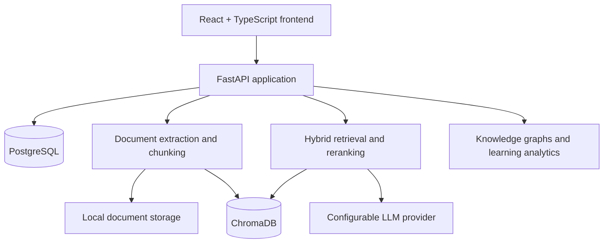

<div align="center">

# Knovera

### Turn Information into Intelligence.

An AI-powered workspace for document research, source-grounded answers, and adaptive learning.

[](https://github.com/devadshukla1/Knovera/actions/workflows/ci.yml)


[Getting started](#getting-started) · [Architecture](#architecture) · [Documentation](#documentation) · [Contributing](CONTRIBUTING.md)

</div>

## Overview

Knovera brings lecture notes, research papers, textbooks, and presentations into one workspace. It combines document ingestion, hybrid retrieval, citation-aware chat, topic discovery, knowledge graphs, and study tools to help users explore what their sources actually say.

**Status:** active development, with a native Windows setup. The current authentication flow supports local-owner access without a valid token. Run it as a trusted local application; public multi-user deployment requires authentication hardening. See [Security](SECURITY.md).

## Features

| Area | Capabilities |
| --- | --- |
| Document intelligence | PDF, DOCX, PPTX, and text extraction; semantic chunking; source provenance; duplicate detection; ingestion retries |
| Research chat | Source-grounded answers, citations, persistent conversations, and configurable LLM providers |
| Hybrid search | Dense embeddings, BM25 lexical retrieval, reciprocal rank fusion, and cross-encoder reranking |
| Query understanding | Logistic regression and SVM intent classification with fallback routing |
| Knowledge exploration | K-means topic discovery, concept extraction, interactive knowledge graphs, and graph-assisted retrieval |
| Study tools | Flashcards, multiple-choice, true/false, fill-in-the-blank exercises, explanations, and quiz history |
| Adaptive learning | Bayesian knowledge tracing, concept mastery, revision recommendations, and learning analytics |
| Research synthesis | Paper metadata and methodology extraction, comparisons, claim verification, contradiction detection, and coverage analysis |

## Architecture



| Layer | Stack |
| --- | --- |
| Interface | React 18, TypeScript, Vite, Tailwind CSS, Radix UI, TanStack Query, Cytoscape.js |
| API | Python 3.12, FastAPI, Pydantic, SQLAlchemy, Alembic |
| Persistence | PostgreSQL 16, ChromaDB, local filesystem |
| ML and retrieval | PyTorch, Sentence Transformers, scikit-learn, NetworkX |
| Validation | Pytest, Vitest, Testing Library, Playwright, GitHub Actions |

## Getting started

### Prerequisites

- Windows 10/11 x64 and PowerShell for the included service scripts.
- Python 3.12, Node.js 20+ with npm, and Git.
- PostgreSQL 16 binaries, either on `PATH` or in `%LOCALAPPDATA%\Programs\PostgreSQL\16\bin`.
- Internet access for dependency installation and the first download of embedding, reranking, or NLI models.

The current frontend manifest includes Windows-specific native packages. The documented setup and frontend CI target Windows; other platforms may require dependency adjustments. Docker is not required, and this repository does not include a Compose configuration.

### 1. Clone and install

```powershell
git clone https://github.com/devadshukla1/Knovera.git
cd Knovera

py -3.12 -m venv .venv
.\.venv\Scripts\python.exe -m pip install --upgrade pip
.\.venv\Scripts\python.exe -m pip install -r backend\requirements.txt
npm.cmd --prefix frontend ci

Copy-Item .env.example .env
Copy-Item frontend\.env.example frontend\.env
```

### 2. Configure

Edit `.env` for your PostgreSQL connection and model/provider preferences. Generate a signing secret with:

```powershell
.\.venv\Scripts\python.exe -c "import secrets; print(secrets.token_hex(32))"
```

Assign the result to `AUTH_SECRET_KEY`. Keep credentials in the root `.env`; browser-visible `VITE_*` variables must never contain secrets.

| Setting | Purpose |
| --- | --- |
| `DATABASE_URL` | PostgreSQL connection using the `postgresql+psycopg` driver |
| `CHROMA_HOST`, `CHROMA_PORT` | ChromaDB endpoint; default port `8001` |
| `FRONTEND_ORIGIN` | Allowed frontend origin; match the address used in your browser |
| `LLM_PROVIDER` | `mock`, `gemini`, `groq`, or `openai_compatible` |
| `LLM_MODEL` | Model identifier for the configured provider |
| `GEMINI_API_KEY`, `GROQ_API_KEY` | Credentials for the corresponding provider |
| `OPENAI_COMPATIBLE_BASE_URL`, `OPENAI_COMPATIBLE_API_KEY`, `OPENAI_COMPATIBLE_MODEL` | Compatible API endpoint, credentials, and model |
| `RETRIEVAL_MODE`, `RERANKER_ENABLED` | Retrieval and reranking behavior |
| `VITE_API_BASE_URL` | Frontend API address, configured in `frontend/.env` |

The template defaults to `LLM_PROVIDER=mock`, which is for development and does not provide real model-generated answers. Select a provider and configure its credentials/model for real generation. See [.env.example](.env.example) for all template settings.

### 3. Initialize and launch

```powershell
.\scripts\windows\setup.ps1
.\run.ps1
```

The setup script initializes local PostgreSQL storage, provisions the development database, and runs migrations. It uses local development credentials and trust authentication; review it before using an existing PostgreSQL installation. If using your own database, provision the role/database yourself, set `DATABASE_URL`, and run migrations directly:

```powershell
.\.venv\Scripts\alembic.exe -c backend/alembic.ini upgrade head
```

| Service | Local address |
| --- | --- |
| Frontend | http://localhost:5173 |
| API documentation | http://localhost:8000/docs |
| Liveness | http://localhost:8000/health |
| Readiness | http://localhost:8000/health/ready |

Readiness requires the backing services to be available. A running API alone does not mean document ingestion or retrieval is ready.

```powershell
# Inspect services and logs
.\scripts\windows\status.ps1
.\scripts\windows\logs.ps1 -Service all -Tail 30

# Stop the local stack
.\stop.ps1
```

See the [Windows operations guide](docs/local_setup_windows.md) for manual service commands and persistence locations.

## Development and testing

Run commands from the repository root:

```powershell
# Backend tests
.\.venv\Scripts\python.exe -m pytest backend/tests

# Frontend unit/component tests and production build
npm.cmd --prefix frontend test
npm.cmd --prefix frontend run build

# Browser tests (install browser runtimes first)
cd frontend
npx.cmd playwright install
npm.cmd run test:e2e
```

Some integration and model tests require services, downloaded models, or provider configuration. Review their fixtures before running against a database containing valuable data. Browser tests use `frontend/playwright.config.ts`, which starts the frontend development server.

[GitHub Actions](.github/workflows/ci.yml) runs selected backend checks and ML evaluations, plus the frontend build and unit tests. It does not run every backend or browser test. The badge above reports the actual workflow result rather than a fixed passing claim.

### Upload validation (November 26, 2026)

- Frontend TypeScript compilation and production build passed.
- 31 backend CI tests passed, together with the RAG evaluation and ML benchmark scripts.
- All 103 frontend tests passed across 22 files after restoring omitted source modules, updating stale UI tests, and adding the JSDOM viewport observer mock. A clean `npm ci` resolved the earlier local esbuild mismatch.
- The full backend suite, browser suite, and fresh-machine setup were not verified during upload preparation.

## Repository layout

```text
.github/              CI workflow and collaboration templates
backend/
  alembic/            Database migrations
  app/                API, domain logic, ingestion, retrieval, and ML services
  scripts/            Training and evaluation entry points
  tests/              Backend tests
frontend/
  src/                React application and component tests
  e2e/                Playwright browser tests
data/                 Seed datasets, schemas, splits, and retrieval benchmarks
models/               Query-intent model artifacts, manifests, and metrics
eval/                 Evaluation resources
docs/                 Product, architecture, schema, and operations documentation
scripts/windows/      Local setup and service management
tests/               Additional integration and unit tests
```

The query-intent dataset is a synthetic seed dataset, not production user data or human-reviewed ground truth. Model manifests record training metadata; serialized scikit-learn artifacts may require compatible library versions. Only load trusted model artifacts.

Private `.env` files, uploaded documents, local databases, model caches, dependencies, and generated build/test output are excluded from Git. The source, migrations, dependency manifests, seed datasets, and bundled query-intent models are included.

## Documentation

- [Summer Internship Report (PDF)](docs/reports/Summer_Internship_Report.pdf)
- [Knovera Project Presentation (PDF)](docs/reports/Knovera_Project_Presentation.pdf)

- [Documentation index](docs/README.md)
- [Windows setup and operations](docs/local_setup_windows.md)
- [System architecture](docs/SYSTEM_ARCHITECTURE.md)
- [Technical requirements](docs/trd.md)
- [Database schema](docs/schema.md)
- [Product requirements](docs/prd.md)
- [Application flows](docs/app_flow.md)
- [Implementation plan](docs/IMPLEMENTATION_PLAN.md)
- [Query-intent dataset](data/query_intent/README.md)
- [Retrieval evaluation dataset](data/retrieval_eval/README.md)

Planning documents and historical reports describe implementation stages; they are not guarantees of current test results or deployment readiness.

## Contributing and security

Read [CONTRIBUTING.md](CONTRIBUTING.md) before proposing changes. Use the issue templates for reproducible bugs and focused feature proposals. For sensitive reports, follow [SECURITY.md](SECURITY.md) and avoid posting credentials or private documents in public issues.

## License

No open-source license has been selected for this repository. Public visibility does not grant permission to reuse or redistribute the code. Third-party dependencies and model weights remain subject to their respective licenses.
