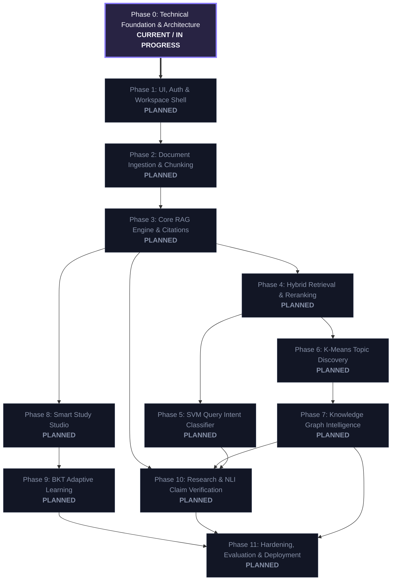

# Knovera — Phased Implementation Plan

| Field | Value |
|---|---|
| Product | **Knovera** |
| Tagline | **Turn Information into Intelligence.** |
| Version | 1.0.0 |
| Current Active Phase | **Phase 0 — Technical Foundation & Architecture (CURRENT)** |
| Future Phases Status | **Phases 1–11 (PLANNED)** |
| Last Updated | 2026-11-05 |
| Technical Baseline | [trd.md](trd.md) |
| Architecture Document | [SYSTEM_ARCHITECTURE.md](SYSTEM_ARCHITECTURE.md) |
| Product Baseline | [prd.md](prd.md) |

> **Execution Mandate:** Knovera executes in strict phased dependency order. A phase is not complete simply because files exist or stubs are created; it is complete **only** when its acceptance criteria, automated tests, and verification checks pass completely. Planned features from subsequent phases must never be claimed or faked as implemented in earlier phases.

---

## 1. Execution Principles

1. **Smallest Vertical Slice**: Implement foundational infrastructure before expanding domain breadth.
2. **Modular Monolith Discipline**: Maintain internal module boundaries via clean Python interfaces; avoid premature microservices, Kafka, Redis, or Kubernetes.
3. **Genuine ML Contributions**: Genuine machine learning algorithms, trained models, and evaluated pipelines are built in their designated phases. Calling a commercial LLM API is not an ML contribution.
4. **Source & Evidence Traceability**: Answers, knowledge graphs, study questions, paper comparisons, and learning recommendations must trace back to stored, validated document chunks.
5. **Data Governance & Integrity**: Synthetic and public benchmark datasets are used for early experiments. Private user data is never used without explicit consent.
6. **Configuration & Secret Isolation**: Zero credentials in source control; environment-driven configuration with Pydantic Settings and strict `.gitignore`.
7. **Transparent Reporting**: Every phase requires an honest verification report in `progress/` recording exact commands, outputs, and any blockers.

---

## 2. Phase Dependency Graph & Roadmap Overview

### Phase Summary Matrix

| Phase | Phase Name | Focus Area | Status | Deliverable Summary |
|---|---|---|---|---|
| **Phase 0** | **Technical Foundation & Architecture** | Core Infrastructure | **COMPLETED** | Scaffolding, Python 3.12 `.venv`, minimal `requirements.txt`, FastAPI health endpoints, React + Vite frontend with real-time connectivity monitor, Docker Compose (Postgres & ChromaDB), configuration safety. |
| **Phase 1** | **Frontend Foundation & UI Shell** | UI Shell & Workspaces | **COMPLETED** | Design system tokens, dashboard overview, workspace CRUD UI & backend API, document collection UI, research chat UI, app sidebar & navigation, Argon2id auth, JWT session security. |
| **Phase 2** | **Document Intelligence & Ingestion** | Ingestion & Extraction | **IN PROGRESS** | C2.1 Upload API (Done), C2.2 PDF Extraction (Done), C2.3 DOCX/PPTX Extraction (Done), C2.4 Text Cleaning (Done), C2.5 Semantic Chunking (Done). Remaining: Async worker, deduplication. |
| **Phase 3** | **Core RAG Engine** | Retrieval & Q&A | **IN PROGRESS** | Sentence Transformers embeddings (C3.1, Done), ChromaDB persistent collections & batch upserts (C3.2, Done), Semantic vector retrieval & pipeline indexing (C3.3, Done). Remaining: LLM prompt abstraction, citation validation, chat UI. |
| **Phase 4** | **Hybrid Retrieval & ML Reranking** | Search Optimization | **PLANNED** | Lexical BM25 indexing, Reciprocal Rank Fusion (RRF), Cross-Encoder reranking, and labelled retrieval benchmark (Recall@K, MRR@K, nDCG@K). |
| **Phase 5** | **Query Intelligence & SVM** | Intent Classification | **PLANNED** | TF-IDF feature extraction, LinearSVC intent classifier (7 classes), confidence calibration, and intelligent workflow query routing. |
| **Phase 6** | **Topic Discovery & K-Means** | Unsupervised ML | **COMPLETED** | Chunk embedding clustering via K-Means, silhouette/Davies-Bouldin evaluation, topic labeling, persistent PostgreSQL relational runs, Topic Discovery API, and interactive Topic Explorer UI. |
| **Phase 7** | **Knowledge Graph Intelligence** | Graph Analytics | **COMPLETED** | Concept extraction, entity normalization, relationship validation, NetworkX multigraph construction, persistent immutable snapshots, authenticated graph APIs, interactive Cytoscape.js canvas UI, and source-linked evidence exploration. |
| **Phase 8** | **Smart Study Studio** | Study Tools | **COMPLETED** | Structured revision notes, single-correct 4-option MCQs, fill-in-the-blank recall exercises, True/False generation with targeted misconception error modeling, active recall flashcards across 8 cognitive categories, and authoritative interactive quiz runner UI with anti-cheat answer shielding. |
| **Phase 9** | **Learner Intelligence & BKT Analytics** | Cognitive Modeling | **COMPLETED** | Complete Bayesian Knowledge Tracing (BKT) cognitive modeling suite: question-concept mapping with provenance (C9.1), append-only learner interaction event logging with anti-tampering (C9.2), quiz attempt lifecycle tracking and concept attribution (C9.3), mathematical 4-parameter BKT inference (C9.4), Baum-Welch EM parameter estimation with hierarchical fallback (C9.5), online mastery updates with concurrency locking and idempotency (C9.6), explainable revision recommendation engine with study material linking (C9.7), responsive learning analytics dashboard UI with score trends and concept attribution (C9.8), and offline BKT evaluation engine with leakage-free holdouts and model readiness gates (C9.9). |
| **Phase 10** | **Research Intelligence & NLI** | Literature Analysis | **COMPLETED** | Complete academic literature intelligence suite: bibliographic metadata extraction (C10.1, Done), research objective/hypothesis/contribution extraction (C10.2, Done), methodology, dataset & experimental setup extraction (C10.3, Done), multi-paper comparison matrix across 7 dimensions (C10.4, Done), empirical finding & limitation contrast with contextual comparability gatekeeping (C10.5, Done), sequence classification NLI integration with margin abstention & benchmark suite (C10.6, Done), multi-tier source evidence validation engine with exact span matching & numerical accuracy (C10.7, Done), staged scientific contradiction detection with metric/population/dataset safeguards and human review lifecycle (C10.8, Done), multi-paper corpus coverage gap analysis with explicit scientific scope disclaimer (C10.9, Done), and consolidated Research Intelligence Dashboard UI (C10.10, Done). |
| **Phase 11** | **Testing, Evaluation & Deployment** | Quality & Release | **IN PROGRESS** | Automated backend testing framework & pytest markers (C11.1, Done), Vitest component suite & Playwright critical journey E2E specs (C11.2, Done), end-to-end RAG retrieval & generation evaluation with abstention benchmarking (C11.3, Done). Remaining: ML benchmark consolidation, security audits, Docker production deployment. |

---

## 3. Phase 0 — Technical Foundation & Architecture (CURRENT)

**Objective**: Establish a clean, verified, and operable technical foundation without introducing premature ML frameworks or complex domain logic.

### 3.1 Deliverables & Chunks

- [x] **C0.1 Requirements and Architecture Audit**:
  - Detailed system architecture specification in `docs/SYSTEM_ARCHITECTURE.md`.
  - Component responsibilities (React frontend, FastAPI backend, PostgreSQL, ChromaDB).
  - Explicit modular monolith boundaries and communication flows.
  - Strict Phase 0 non-ML boundary definition.
- [x] **C0.2 Git Repository and Folder Structure**:
  - Git repository initialization with `main` branch.
  - Clean separation of `frontend/`, `backend/`, `docs/`, `progress/`, `tests/`.
  - Comprehensive `.gitignore` excluding `.env`, `.venv/`, `node_modules/`, `storage/`, database files, and build artifacts.
  - `.gitattributes` enforcing consistent line endings.
- [x] **C0.3 Python Virtual Environment & Dependencies**:
  - Python 3.12 virtual environment created at root `.venv` via `py -3.12 -m venv .venv`.
  - Clean, minimal `backend/requirements.txt` containing FastAPI, Uvicorn, Pydantic v2, Pydantic Settings, SQLAlchemy 2.x, Psycopg 3, Alembic, ChromaDB, Pytest, and HTTPX.
  - **Zero heavyweight ML libraries** (verified absence of PyTorch, TensorFlow, transformers, sentence-transformers, scikit-learn).
- [x] **C0.4 FastAPI Backend Initialization**:
  - Application factory under `backend/app/main.py`.
  - API versioned aggregator under `backend/app/api/v1/router.py`.
  - Pydantic Settings configuration (`backend/app/core/config.py`) loading safe defaults.
  - Structured logging with credential sanitization (`backend/app/core/logging.py`).
  - CORS middleware allowing `FRONTEND_ORIGIN`.
  - Public liveness probe: `GET /health` and `GET /api/v1/health` (returns 200 OK).
  - Dependency readiness probe: `GET /health/ready` and `GET /api/v1/health/ready` checking PostgreSQL (`SELECT 1`) and ChromaDB (`heartbeat()`).
  - Graceful degradation: backend starts and remains operable even if PostgreSQL or ChromaDB is down, returning 503 on readiness without leaking secrets.
  - Backend automated test suite (Pytest) validating health probes and degraded states.
- [x] **C0.5 React + TypeScript Frontend Foundation**:
  - Vite + React + strict TypeScript application under `frontend/`.
  - Tailwind CSS configuration mapping dark/light semantic design tokens from `docs/design_brief.md`.
  - Reusable typed API service (`frontend/src/services/api.ts`) reading `VITE_API_BASE_URL`.
  - Landing view at `/` presenting "Knovera", tagline "Turn Information into Intelligence", and real-time backend connectivity status card (Loading, Connected, and Error states).
  - Production build verification (`npm run build` succeeds with zero errors).
- [x] **C0.6 PostgreSQL & ChromaDB Services Configuration**:
  - `docker-compose.yml` specifying PostgreSQL 16+ and pinned ChromaDB (`chromadb/chroma:1.5.9`).
  - Persistent volume definitions (`postgres_data`, `chroma_data`) and container healthchecks.
  - SQLAlchemy 2.x session manager with lazy connection pooling (`pool_pre_ping=True`).
  - Alembic baseline initialization (`alembic.ini` and `backend/alembic/`) with zero domain tables.
  - ChromaDB HTTP client wrapper (`backend/app/db/chroma.py`).
- [x] **C0.7 Environment Variables & Configuration Safety**:
  - Root `.env.example` documenting all server, database, vector, and placeholder variables.
  - Frontend `frontend/.env.example` containing only public browser-safe `VITE_API_BASE_URL`.
  - Zero secrets committed to source control.

### 3.2 Acceptance Criteria for Phase 0
- [x] Python 3.12 virtual environment `.venv` imports cleanly and passes version assertion (`sys.version_info[:2] == (3, 12)`).
- [x] Minimal backend dependencies install cleanly without conflicts or heavyweight ML bloat.
- [x] FastAPI backend starts and serves `GET /health` returning `200 OK`.
- [x] `GET /health/ready` accurately reports status of PostgreSQL and ChromaDB.
- [x] Backend starts and remains responsive even when database services are down, returning `503 Service Unavailable` with safe masked diagnostics.
- [x] Backend test suite (pytest) executes and passes 100%.
- [x] Frontend installs dependencies (`npm install`) and builds successfully (`npm run build`) without TypeScript or bundling errors.
- [x] Frontend landing page renders Knovera branding, tagline, and dynamically reflects backend connectivity state.
- [x] `docker-compose.yml` validates syntactically with correct volume and port allocations.
- [x] `.gitignore` prevents `.env`, `.venv`, and `node_modules` from being committed.
- [x] Comprehensive documentation exists: `docs/SYSTEM_ARCHITECTURE.md`, `docs/IMPLEMENTATION_PLAN.md`, root `README.md`, and `progress/PHASE_0_REPORT.md`.

---

## 4. Phase 1 — Frontend Foundation, Authentication & Workspace Shell (PLANNED)

**Objective**: Deliver the authenticated workspace shell, protected navigation, account sessions, and personal workspaces.

### Chunks (PLANNED)
- [ ] **C1.1 Design System & Theme Components**: Atomic UI primitives (Button, Input, Card, Alert, Badge, Skeleton, Dialog) using Radix UI primitives and Tailwind tokens.
- [ ] **C1.2 Public Entry & Authentication Views**: Registration (`/register`) and Login (`/login`) forms with client-side Zod validation and safe error handling.
- [ ] **C1.3 Backend Authentication Service**: Argon2id password hashing, JWT access tokens (15-min lifespan), rotating refresh tokens (30-day lifespan), and cookie/bearer session management.
- [ ] **C1.4 Protected Routing & Session Lifecycle**: React Router guards, automatic session refresh interceptor, and logout cache cleanup.
- [ ] **C1.5 Application Shell & Navigation**: Persistent sidebar, top bar, breadcrumbs, responsive mobile drawer, and user profile menu.
- [ ] **C1.6 Overview Dashboard**: Empty-state guidance for new users, recent workspaces list, and system health status.
- [ ] **C1.7 Workspace Management CRUD**: Endpoints and UI to create, list, rename, view, and delete personal workspaces with owner verification.
- [ ] **C1.8 Workspace Isolation Enforcement**: Row-Level Security (RLS) context and backend dependency verifying workspace ownership on all subsequent API calls; negative tests proving cross-user access rejection.
- [ ] **C1.9 Frontend API State Integration**: TanStack Query integration for caching, optimistic updates, and automatic cache invalidation.

---

## 5. Phase 2 — Document Intelligence & Ingestion (COMPLETED)

**Objective**: Accept supported documents (PDF, DOCX, PPTX) and transform them into traceable, searchable chunks with page-level provenance, robust error handling, and duplicate detection.

### Chunks
- [x] **C2.1 File Upload API & Private Storage Adapter (COMPLETED)**:
  - Multi-tier validation: `.pdf`, `.docx`, `.pptx` extension, MIME type, magic byte signature (first 1024 bytes), 0-byte check.
  - Streaming chunked file upload (64KB chunks) with on-the-fly SHA-256 computation and strict `MAX_UPLOAD_SIZE_BYTES` (25MB) HTTP 413 rejection.
  - Private filesystem storage adapter (`LocalStorageService`) isolated outside web roots with strict path traversal rejection (`Path.relative_to(root)`).
  - Atomic write strategy (`.tmp` -> replace) with automatic cleanup on error.
  - Workspace ownership verification (HTTP 404 for unowned workspaces).
- [x] **C2.2 PDF Extraction Pipeline & Provenance (COMPLETED)**:
  - PyMuPDF (`PyMuPDFExtractor`) page-by-page extraction with layout order (`sort=True`).
  - 1-based page numbering preserved in relational `document_pages` table (`UNIQUE(document_id, page_number)`).
  - Scanned / zero-text PDF detection (`is_scanned`) transitioning document to `failed` with code `no_extractable_text`.
  - Encrypted / password-protected PDF rejection with code `pdf_encrypted`.
  - Configurable safety guardrails: `MAX_PDF_PAGES` (500) and `MAX_EXTRACTED_TEXT_CHARS` (20,000,000).
  - Lifecycle state management: successful extraction marks document `queued` with stage `extraction_complete_awaiting_chunking` (never `ready` in Phase 2).
- [x] **C2.3 DOCX and PPTX Extraction (COMPLETED)**:
  - `python-docx` extractor preserving heading hierarchy (levels 1–9, `section_path`), paragraphs, and formatted tables.
  - `python-pptx` extractor preserving 1-based `slide_number`, slide titles, reading-ordered shapes, bullet hierarchy, and slide tables.
  - Common unified representation: `ExtractedDocument` composed of ordered `ExtractedBlock`s.
  - Format dispatcher routing `.pdf`, `.docx`, `.pptx`.
- [x] **C2.4 Text Cleaning and Normalisation (COMPLETED)**:
  - Deterministic normalizer (`TextNormalizer`): Unicode NFC, line-ending standardization, NUL/control character removal.
  - Conservative line-break dehyphenation preserving legitimate compound terms (`self-`, `multi-`, `cross-`).
  - Whitespace collapse preserving paragraph boundaries and table formatting.
  - Absolute preservation: Accents, Greek letters, math symbols, currency, code, and stop-words.
  - Full telemetry: `CleaningMetadata` tracking characters, control chars, dehyphenations.
- [x] **C2.5 Semantic Chunking & Source Provenance (COMPLETED)**:
  - Structure-aware, content-aware semantic chunker (`SemanticChunker`): 500 target tokens, 700 max tokens, 80 min tokens, 75 overlap tokens.
  - Zero-dependency token estimator (`EstimateTokenCounter`).
  - Robust sentence boundary segmentation (`SentenceBoundaryDetector`) preserving abbreviations (`e.g.`, `Dr.`), decimals, and URLs.
  - Context-preserving overlap (`OverlapManager`) resetting across distinct section/slide boundaries.
  - Oversized table splitting at row boundaries with repeated column headers.
  - PPTX slide boundary isolation and PDF page range tracking (`page_start`, `page_end`).
  - Deterministic chunk identity: UUID5 generated from `(document_id, chunking_version, chunk_index, content_hash)`.
  - Source provenance: `source_segments` JSONB array linking chunks to exact blocks and source coordinates.
  - Relational persistence in `document_chunks` table with unique constraint and indexes.
  - Lifecycle state: `queued` (stage `awaiting_embeddings`, never `ready` in Phase 2).
- [x] **C2.6 Metadata and Page Tracking (COMPLETED)**:
  - Full document metadata schema (`DocumentMetadata` Pydantic model) tracking counts (pages, slides, blocks, characters, chunks) and version telemetry.
  - Database persistence of `slide_count`, `extracted_block_count`, `total_characters`, `chunk_count`, `pipeline_version`.
  - Provenance validation (`ProvenanceValidator`) verifying 1-based coordinates (`page_start >= 1`, `slide_number >= 1`), non-empty `source_segments`, coordinate bounds, and identity coherence.
- [x] **C2.7 Document Processing Pipeline (COMPLETED)**:
  - End-to-end 8-stage orchestrator (`DocumentProcessingPipeline`): Validation -> Extraction -> Cleaning -> Metadata Assembly -> Semantic Chunking -> Provenance Validation -> Transactional Persistence -> State Transition (`queued`, stage `awaiting_embeddings`).
  - Persistent job tracking (`IngestionJob` model and table) recording worker leases (`locked_at`, `locked_by`), stage metrics, attempt counts, and duration telemetry.
  - Idempotent document reprocessing (`POST /api/v1/workspaces/{workspace_id}/documents/{document_id}/reprocess`) cleanly replacing chunks without duplicates.
  - Document jobs history endpoint (`GET /api/v1/workspaces/{workspace_id}/documents/{document_id}/jobs`).
- [x] **C2.8 Error Handling and Duplicate Detection (COMPLETED)**:
  - Workspace-scoped SHA-256 duplicate detection returning HTTP 409 Conflict with `existing_document_id`.
  - Database-level concurrency protection via unique partial index `uq_documents_workspace_sha256_active` on `(workspace_id, sha256) WHERE deleted_at IS NULL`.
  - Standardized error taxonomy (`PERMANENT_ERRORS` vs `RETRYABLE_ERRORS`) with user-safe error summaries.
  - Bounded retry logic with exponential backoff (`base * 2^(attempt - 1)` capped at max delay) and stale worker lease recovery.
- [ ] **C2.9 Document Library UI**: Table view with real-time status badges, upload progress, document deletion, and failed-job retry triggers.
- [ ] **C2.10 Cascading Deletion Hooks**: Clean deletion of stored files, metadata, chunks, and scheduled vector index purge.

---

## 6. Phase 3 — Core RAG Engine (IN PROGRESS)

**Objective**: Deliver source-grounded multi-document question answering with strict citation validation and semantic vector retrieval.

### Chunks
- [x] **C3.1 Embedding Model Integration (COMPLETED)**:
  - Integration of compact local Sentence Transformers embedding model (`sentence-transformers/all-MiniLM-L6-v2`, 384 dimensions, CPU default).
  - Deterministic fake embedding provider (`DeterministicFakeEmbeddingProvider`) for fast, offline, and CI test execution.
  - Thread-safe singleton model lifecycle manager (`EmbeddingModelManager`) with lazy loading and readiness checks.
  - Model caching in configurable directory (`./storage/model_cache`).
- [x] **C3.2 ChromaDB Integration (COMPLETED)**:
  - Persistent ChromaDB collection management with deterministic naming: `knovera_chunks_{model_part}_{dimension}`.
  - Cosine distance space (`hnsw:space: "cosine"`) and dimensional integrity metadata.
  - Resilient batch upserts (`CHROMA_INSERT_BATCH_SIZE=100`) with idempotency via stable chunk UUIDs.
  - Server-enforced metadata filtering (`workspace_id`, `document_id`) and lifecycle deletion hooks (`delete_by_document`, `delete_by_workspace`).
  - Vector index reconciliation comparing PostgreSQL chunk counts with Chroma collection counts.
- [x] **C3.3 Semantic Vector Retrieval & Pipeline Integration (COMPLETED)**:
  - Ingestion pipeline Stage 8 integration: Converts semantic chunks to dense vectors and upserts into ChromaDB.
  - State transition enforcement: Document status transitions to `ready` (stage `ready`) **only** after vector indexing is verified.
  - `POST /api/v1/workspaces/{workspace_id}/search/semantic` endpoint with workspace ownership verification.
  - Authoritative PostgreSQL hydration: Source text and provenance (`source_segments`, `page_start`, `slide_number`) are hydrated from PostgreSQL, preserving cosine distance ranking.
  - Exclusion of soft-deleted documents (`deleted_at IS NOT NULL`) and unowned workspaces.
  - Baseline retrieval benchmark achieving 100% Recall@5, 100% Recall@10, and 12.18ms average latency.
- [x] **C3.4 LLM Provider Abstraction (COMPLETED)**:
  - Provider-independent LLM architecture (`backend/app/llm/`) with strict zero-cloud-SDK constraint.
  - Normalised Pydantic schemas: `LLMGenerationRequest`, `LLMGenerationResponse`, `ChatMessage`, `TokenUsage`.
  - Concrete adapter implementations: `MockLLMProvider`, `GeminiProvider` (Google REST API), `GroqProvider`, and `OpenAICompatibleProvider` (Ollama/vLLM/OpenAI-compatible) using HTTPX.
  - Thread-safe registry (`LLMProviderRegistry`) and orchestrator (`LLMManager`) with bounded retries, exponential backoff, jitter, and SSRF prevention.
  - Model capabilities tracking context windows, token limits, and function/JSON support.
- [x] **C3.5 Context Construction & Assembly (COMPLETED)**:
  - Robust context assembly pipeline (`backend/app/rag/context/`): `ContextBuilder`, `TokenBudgetCalculator`, `EvidenceDeduplicator`, `EvidenceSelector`, `SourceFormatter`.
  - Authoritative PostgreSQL revalidation filtering out soft-deleted documents and rejecting cross-workspace leakage with `ContextScopeError`.
  - Conservative token budgeting reserving space for model output, system prompts, and conversation history.
  - Multi-document diversity enforcement (`CONTEXT_MAX_CHUNKS=8`, `CONTEXT_MAX_CHUNKS_PER_DOCUMENT=4`) with sentence-boundary truncation.
  - Source ID assignment (`[S1]`, `[S2]`) with comprehensive provenance formatting for PDF pages, PPTX slides, and DOCX sections.
- [x] **C3.6 Prompt Engineering & Structured Output (COMPLETED)**:
  - Versioned prompt framework (`backend/app/rag/prompts/`): `GeneralQAPrompt` (`general-qa-v1`), `CORE_SYSTEM_PROMPT`.
  - Anti-prompt-injection isolation delimiting untrusted document chunks inside `<document_evidence>` blocks with explicit instruction override bans.
  - Reusable structured output schema (`StructuredAnswerDraft`, `FactClaim`) enforcing claim-level source ID attribution.
  - Robust JSON output parser (`StructuredOutputParser`) with markdown fence extraction, schema validation, and source ID verification against context mapping.
- [x] **C3.7 Source-Grounded Response Generation (COMPLETED)**:
  - Reusable RAG orchestration engine (`GroundedAnswerService` under `backend/app/rag/orchestration/`) unifying retrieval, context assembly, prompt engineering, generation, and citation mapping.
  - Strict evidence abstention policies (`AbstentionPolicy`): Returns explicit, truthful abstention without invoking LLM if workspace has no active chunks or retrieval yields zero matches.
  - Multi-source grounded synthesis: Maps factual claims to prompt-local source IDs (`[S1]`, `[S2]`) and gracefully isolates conflicting evidence.
  - Token and latency telemetry: Tracks prompt tokens, completion tokens, latency milliseconds, and provider/model metadata.
- [x] **C3.8 Citation and Page-Reference Mapping (COMPLETED)**:
  - Provenance validation subsystem (`backend/app/citations/`): `CitationValidator` ensures citations strictly resolve to authoritative PostgreSQL chunks belonging to the current workspace.
  - Multi-format location mapper (`CitationMapper`): 1-based PDF pages (`page_start`, `page_end`), DOCX hierarchical sections (strictly preventing synthetic page hallucination), and 1-based PPTX slide numbers.
  - Persistence & API: `Citation` entity with relational links (`workspace_id`, `message_id`, `chunk_id`, `claim_index`, `quote_text`, `relevance_score`) and secure endpoint `GET /api/v1/citations/{citation_id}` enforcing workspace authorization.
- [x] **C3.9 Conversation History & Persistence (COMPLETED)**:
  - Persistent conversation and message subsystem (`backend/app/conversations/`): Tables `conversations` and `messages` in PostgreSQL managed via Alembic migration (`20261106_004_conversations_messages_citations.py`).
  - Client request idempotency: Unique partial constraint on `(conversation_id, client_request_id)` preventing duplicate user submissions on retries or network blips.
  - Concurrency & failure recovery: Active generation guard preventing simultaneous generations per conversation, with 300-second stale lease recovery and failure status persistence.
  - Automatic conversation title generation derived from the opening user query.
  - Endpoints: `POST /api/v1/workspaces/{workspace_id}/conversations`, `GET /api/v1/workspaces/{workspace_id}/conversations`, `GET /api/v1/conversations/{conversation_id}`, and `POST /api/v1/conversations/{conversation_id}/messages`.

---

## 7. Phase 4 — Hybrid Retrieval & ML Reranking (IN PROGRESS)

**Objective**: Elevate retrieval precision by fusing dense semantic retrieval with sparse lexical retrieval and cross-encoder reranking.

### Chunks
- [x] **C4.1 BM25 Lexical Retrieval & Inverted Index (COMPLETED)**:
  - Okapi BM25 implementation with smoothed non-negative IDF ($IDF(t) = \ln(1 + (N - n(t) + 0.5) / (n(t) + 0.5))$), $k_1 = 1.5$, $b = 0.75$.
  - Dedicated lexical tokenizer (`BM25Tokenizer`) preserving technical terms, acronyms, and programming languages (`C++`, `C#`, `TCP/IP`, `PostgreSQL`, `FastAPI`, `BM25`, `GPT-4`, `RAG`).
  - Thread-safe in-memory workspace inverted index (`BM25WorkspaceIndex`) with LRU cache (`BM25IndexCache`) and concurrency build locking.
  - Automatic cache invalidation hooks in document ingestion pipeline (Stage 8) and document deletion.
- [x] **C4.2 Hybrid Retrieval Engine (COMPLETED)**:
  - Parallel hybrid retrieval orchestration (`HybridRetriever`) combining dense vector search from ChromaDB and BM25 lexical search.
  - Configurable candidate pool sizes (`DENSE_RETRIEVAL_TOP_K=20`, `BM25_RETRIEVAL_TOP_K=20`, `HYBRID_RETRIEVAL_TOP_K=10`).
  - Pluggable retrieval modes (`hybrid`, `semantic`, `bm25`).
  - Single authoritative PostgreSQL hydration (`ResultHydrator.hydrate_hybrid_results`) preserving exact fused rankings and excluding soft-deleted documents.
  - REST endpoints: `POST /api/v1/workspaces/{workspace_id}/search/hybrid` and `POST /api/v1/workspaces/{workspace_id}/search/bm25`.
  - Integration into `GroundedAnswerService` by default.
- [x] **C4.3 Reciprocal Rank Fusion (RRF) (COMPLETED)**:
  - Reciprocal Rank Fusion component (`ReciprocalRankFusion`) implementing $RRF(d) = \sum \frac{1}{k + rank_r(d)}$ with configurable $k=60$.
  - Deduplication by chunk UUID with score accumulation and retrieval source tracking (`semantic`, `bm25`).
  - Deterministic tie-breaking on `str(chunk_id)` preventing ordering variance.
- [x] **C4.4 Cross-Encoder Reranker Integration (COMPLETED)**:
  - Integration of `cross-encoder/ms-marco-MiniLM-L-6-v2` via `sentence_transformers.CrossEncoder`.
  - Thread-safe lazy singleton lifecycle manager (`CrossEncoderModelManager`) with automatic hardware device selection (`cpu`, `cuda`, `auto`).
  - Raw uncalibrated logit scoring service (`CrossEncoderReranker`) with batched inference and non-finite score rejection.
  - Configurable failure policies (`error` vs `rrf_only`) ensuring high-availability fallback.
- [x] **C4.5 Candidate Selection and Reranking (COMPLETED)**:
  - Bounded candidate selection from RRF output (`RERANKER_CANDIDATE_K=50` down to `RERANKER_FINAL_K=10`).
  - Passage text formatting incorporating section headings (`section_title\ncontent`).
  - Deterministic tie-breaking sort (`-reranker_score`, `rrf_rank`, `chunk_id`).
  - Authoritative PostgreSQL hydration preserving reranked order, feeding seamlessly into downstream `ContextBuilder` and `GroundedAnswerService`.
- [x] **C4.7 Recall@K, MRR and nDCG Evaluation (COMPLETED)**:
  - Mathematically rigorous IR metrics suite (`backend/app/rag/evaluation/metrics.py`) implementing Recall@K, MRR@K, nDCG@K (using standard $2^{rel}-1 / \log_2(i+1)$ formulation and IDCG normalization), Precision@K, and MAP@K.
  - Multi-cutoff evaluation across $K \in \{5, 10, 20, 50\}$.
  - Configurable binary relevance threshold (`RELEVANCE_THRESHOLD=2`) distinguishing marginal vs relevant chunks.
  - Deduplication of retrieved chunk IDs before metric evaluation preserving initial rank order.
  - Query eligibility handling: queries with zero relevant chunks are excluded from the macro denominator and reported separately.
  - Two-stage evaluation distinguishing candidate-stage recall (before reranking) from final-stage recall (after reranking).
  - Dataset integrity validation engine (`backend/app/rag/evaluation/validation.py`) checking 10 data quality rules.
- [x] **C4.8 Retrieval Parameter Optimisation (COMPLETED)**:
  - Parameter optimization experiment runner (`backend/scripts/optimize_retrieval.py`) systematically exploring bounded search spaces across `dense_top_k`, `bm25_top_k`, `bm25_k1`, `bm25_b`, `rrf_k`, and `reranker_candidate_k`.
  - Baseline quality and latency measurement on development split (`dev`).
  - Multi-objective Pareto-frontier computation across (nDCG@10, Recall@10, p95 latency).
  - Lexicographic configuration selection strategy with quality regression protection rules.
  - Preservation of holdout `test` split, with one-time frozen test evaluation and JSON artifact outputs in `eval/optimization_results/`.
  - Protection of production configuration: runtime settings are not automatically mutated.

---

## 8. Phase 5 — Query Intelligence & SVM (IN PROGRESS)

**Objective**: Train, evaluate, and integrate an SVM query intent classifier for adaptive request routing.

### Chunks
- [x] **C5.1 Define Query Intent Categories (COMPLETED)**:
  - Centralized taxonomy registry (`backend/app/ml/query_intent/taxonomy.py`) defining 13 mutually exclusive primary intents: `factual_lookup`, `definition`, `explanation`, `comparison`, `summarization`, `procedural_guidance`, `analytical_reasoning`, `information_extraction`, `source_evidence`, `recommendation`, `general_conversation`, `unsupported_action`, and `ambiguous`.
  - Formal inclusion/exclusion criteria, positive examples, borderline cases, and annotation guidance.
  - Multi-intent precedence hierarchy for deterministic primary intent disambiguation.
  - Auxiliary query attributes schema (`AuxiliaryQueryAttributes`) capturing conversation context, multi-source evidence, citation requests, and ambiguous references.
  - Taxonomy versioning (`1.0.0`) and JSON export (`data/query_intent/taxonomy.json`).
- [x] **C5.2 Prepare Labelled Dataset (COMPLETED)**:
  - Structured dataset layout under `data/query_intent/` (`raw/`, `processed/`, `splits/`, `schemas/`, `annotation/`).
  - Curated seed corpus of 455 examples across all 13 categories (35 queries per class) covering Computer Science, Biology, Physics, Mathematics, and general research workflows.
  - Clear provenance tracking (`source_type="synthetic_seed"`, `annotation_status="pending_human_review"`).
  - Deterministic stratified splits (Random Seed 42: Train 312 / 68.6%, Dev 65 / 14.3%, Test 78 / 17.1%) with near-duplicate grouping preventing train/test leakage.
  - Dataset validation utility (`backend/app/ml/query_intent/dataset_validator.py`) verifying schema conformity, duplicate IDs, conflicting labels, and split invariants.
  - Annotation guidelines document (`data/query_intent/annotation/annotation_guidelines.md`) and adjudication template.
- [x] **C5.3 Text Preprocessing (COMPLETED)**:
  - Reusable, deterministic text preprocessing pipeline (`backend/app/ml/query_intent/preprocessing.py`) (version `1.0.0`).
  - Input validation, length truncation (`max_length=512`), and flag tracking (`was_truncated`).
  - Unicode NFKC normalization, control character removal, and smart quotes/dashes normalization.
  - Safe sensitive data redaction (`[EMAIL]`, `[PHONE]`, `[API_KEY]`, `[TOKEN]`).
  - Technical token preservation for programming languages and domain terms (`C++`, `C#`, `TCP/IP`, `BM25`, `TF-IDF`, `K-Means`, `GPT-4`, `PostgreSQL`, `FastAPI`).
  - Stopword preservation for question/intent words (`what`, `why`, `how`, `compare`, `explain`, `summarize`).
  - Dataset preparation runner (`backend/scripts/prepare_query_intent_dataset.py`) generating processed records, splits, and `manifest.json`.
- [x] **C5.4 Feature Extraction Pipeline (COMPLETED)**:
  - Sub-linear TF-IDF vectorization with word (1–2) and character-wb (3–5) n-grams (`backend/app/ml/query_intent/features.py`).
  - Strict technical token regex preservation (`C++`, `C#`, `TCP/IP`, `BM25`, `TF-IDF`, `K-Means`, `GPT-4`, `PostgreSQL`, `FastAPI`).
  - FeatureUnion combined representation (13,074 dimensions, ~1.06% density) fitted strictly on the `train` split preventing data leakage.
- [x] **C5.5 Logistic Regression Baseline (COMPLETED)**:
  - Benchmark baseline model training (`backend/app/ml/query_intent/logistic_model.py`, `backend/scripts/train_logistic_regression.py`).
  - Bounded hyperparameter search on dev split ($C=10.0$, `combined` features, Macro F1 = 0.8941, Accuracy = 0.8923).
  - Serialized pipeline artifact and manifest in `models/query_intent/logistic_regression/`.
- [x] **C5.6 LinearSVC Model Optimization (COMPLETED)**:
  - LinearSVC training pipeline (`backend/app/ml/query_intent/svm_model.py`, `backend/scripts/train_svm.py`) with `dual="auto"`.
  - Bounded hyperparameter search on dev split ($C=1.0$, `word` features, Macro F1 = 0.8920, Accuracy = 0.8923).
  - Serialized pipeline artifact and manifest in `models/query_intent/linear_svm/`.
  - Comprehensive model comparison and error analysis (`backend/scripts/compare_query_intent_models.py`), promotion of winning model to `models/query_intent/selected_model/`, and frozen holdout evaluation on `test` split (Accuracy = 0.8333, Macro F1 = 0.8330).
  - Offline prediction service (`backend/app/ml/query_intent/predictor.py`).
- [x] **C5.7 Model Evaluation & Error Analysis (COMPLETED)**:
  - Evaluation reporting Accuracy, Macro/Weighted Precision, Recall, F1, and 13x13 confusion matrix on dev and test splits.
  - Multiclass probability calibration evaluation: Log Loss (0.7516), Brier Score (0.3080), Expected Calibration Error (ECE: 0.3203, MCE: 0.8503).
  - Explicit confidence output taxonomy (`uncalibrated_probability`, `decision_score`, `unavailable`) and empirical error analysis.
  - Frozen holdout evaluation on test split (78 queries): Test Accuracy = 0.8333, Test Macro F1 = 0.8330.
- [x] **C5.8 API Integration & Model Lifecycle (COMPLETED)**:
  - Process-level thread-safe singleton service (`QueryIntentService` in `backend/app/ml/query_intent/service.py`).
  - Artifact integrity verification (SHA-256, taxonomy v1.0.0, preprocessing v1.0.0, 13 classes).
  - Non-blocking asynchronous inference offloaded to worker thread via `asyncio.to_thread`.
  - Authenticated FastAPI endpoints `POST /api/v1/query/intent` and `POST /api/v1/query-intent/predict` with workspace authorization and Pydantic v2 schemas.
  - Diagnostic readiness endpoint `GET /api/v1/query-intent/readiness`.
  - Configurable failure policies (`default_rag` vs `controlled_error`).
- [x] **C5.9 Intent-Based Module Routing & Chat Integration (COMPLETED)**:
  - Centralized routing registry (`IntentRouter` in `backend/app/ml/query_intent/router.py`) mapping all 13 categories to logical modules and retrieval profiles.
  - Empirically calibrated confidence threshold ($\tau = 0.30$ yielding 92.73% accuracy on dev split).
  - Explicit disambiguation between high-confidence `ambiguous` (clarification prompt) and low-confidence predictions (default RAG fallback).
  - Full chat workflow integration in `ConversationService.submit_message()`:
    - Knowledge intents dispatched to `GroundedAnswerService` with specialized retrieval profiles.
    - `general_conversation` handled via LLM without document retrieval.
    - `unsupported_action` handled via capability boundary explanation.
    - `ambiguous` handled via structured clarification request.
    - Intent classification and routing metadata persisted in `assistant_message.retrieval_metadata`.
- [ ] **C5.10 Intent Observability**: Aggregate intent distribution metrics without logging private query contents.

---

## 9. Phase 6 — Topic Discovery & K-Means (IN PROGRESS)

**Objective**: Discover thematic clusters across workspace document collections via unsupervised K-Means clustering.

### Chunks
- [x] **C6.1 Chunk Embedding Dataset Assembly**: Gathering normalized chunk embeddings for an active workspace, ChromaDB cache reuse, zero-norm guard, and L2 unit-norm guarantee.
- [x] **C6.2 Corpus Eligibility & Minimums**: Data quality gates, cryptographic dataset snapshots (`embeddings.npy`, `records.jsonl`, `manifest.json`), schema validation, and row alignment.
- [x] **C6.3 K-Means Clustering Implementation**: Scikit-learn K-Means implementation with deterministic seeding (`n_init=20`, `random_state=42`), candidate $K$ evaluation (Inertia, Silhouette Euclidean/Cosine, Davies-Bouldin, Calinski-Harabasz), centroid extraction, top representative chunks, and model artifact persistence.
- [x] **C6.4 K Selection and Silhouette Analysis**: Multi-criteria $K$ evaluation service, inertia drop & elbow analysis, Euclidean & Cosine silhouette analysis, per-cluster cohesion & negative silhouette diagnostics, deterministic sampling for large corpora, and label-invariant Adjusted Rand Index (ARI) stability.
- [x] **C6.5 Cluster Labelling**: Grounded cluster keyword extraction via cluster-level TF-IDF (unigrams & bigrams), canonical chunk text hydration, representative chunk synthesis, deterministic title & description composition, safe neutral fallbacks, optional LLM assistance, and preservation of human-approved topic labels.
- [x] **C6.6 Store Topic Assignments**: Authoritative relational persistence in PostgreSQL (`topic_clustering_runs`, `topics`, `topic_assignments`), Alembic migration `20261107_005`, unique constraints, multi-tenant workspace isolation, single-active-run transactional lifecycle, historical run preservation, and idempotent retries.
- [x] **C6.7 Topic Discovery API**: Authenticated REST API endpoints exposing persisted topics, historical run pagination, single run metadata detail, single topic detail with stats, and paginated assigned chunks with source document provenance and soft-delete exclusion.
- [x] **C6.8 Topic Explorer UI**: Responsive frontend interface integrated into Knovera sidebar navigation, featuring active run metric cards, historical run selector dropdown, search & sorting toolbar, responsive topic card grid, and deep topic detail view with assigned chunk inspection and provenance links.

---

## 10. Phase 7 — Knowledge Graph Intelligence (COMPLETED)

**Objective**: Extract, construct, validate, persist, and interactively explore an evidence-backed concept relationship graph using NetworkX and Cytoscape.js.

### Chunks
- [x] **C7.1 Concept Entity Extraction**: High-precision deterministic and LLM-assisted extraction of technical concepts, algorithms, models, datasets, and metrics with exact Unicode character offsets.
- [x] **C7.2 Entity Normalization & Canonicalization**: Punctuation-preserving normalization (C++, C#, Node.js, TF-IDF), domain alias registry, homonym disambiguation, and canonical deduplication.
- [x] **C7.3 Relationship Extraction**: Typed, directional relationship extraction with strict co-occurrence rejection, negation detection, epistemic modality, and multi-source evidence consolidation.
- [x] **C7.4 Relationship Validation**: Rigorous validation of candidate relationships (endpoint resolution, ontology domain/range constraints, reflexive self-loops, exact evidence character offset spans, stale content hash detection, modality flags, and contradiction detection).
- [x] **C7.5 NetworkX Graph Construction**: In-memory directed multigraph (`networkx.MultiDiGraph`) with deterministic node/edge sorting, parallel edge preservation, isolated node retention, structural integrity checks, and topological statistics (`GraphStatisticsService`).
- [x] **C7.6 Graph Persistence**: Versioned, immutable, workspace-scoped graph snapshot persistence. PostgreSQL registry (`knowledge_graph_snapshots` table + migration `20261107_007`), atomic file writes (`.tmp` -> verification -> rename), sidecar `manifest.json`, SHA-256 cryptographic checksums, active snapshot lifecycle management, and fallback reconstruction from PostgreSQL canonical records.
- [x] **C7.7 Graph API**: Authenticated workspace-scoped REST API endpoints (`/workspaces/{id}/knowledge-graph/...`) exposing graph overview, node search, node details, bounded neighborhood subgraph traversal, relationships, relationship details, relationship evidence with verified offsets, node surface mentions, multi-hop path exploration, and snapshot history.
- [x] **C7.8 Interactive Graph Visualisation**: Interactive graph canvas using Cytoscape.js featuring force-directed layouts (COSE, Concentric, Breadth-First, Grid), dark-mode styling (Concepts in violet, Entities in teal, distinct category palettes), zoom/pan, node/edge tap selection, incremental 1-hop/2-hop neighborhood expansion, and historical snapshot switching.
- [x] **C7.9 Source-Linked Graph Exploration**: Direct provenance exploration linking concepts and relationships back to original PDF, DOCX, and PPTX documents via location-aware parameters (`page_start`, `slide_number`, `section_title`, chunk ID, and exact character offsets), plus bounded multi-hop path explorer with reasoning chains.

---

## 11. Phase 8 — Smart Study Studio (COMPLETED)

**Objective**: Convert document evidence into structured revision notes, flashcards, and interactive self-assessment quizzes.

### Chunks
- [x] **C8.1 Revision Note Generator (COMPLETED)**: Synthesizing structured academic revision notes across configurable lengths, detail tiers, and pedagogical focus styles with strict source grounding.
- [x] **C8.2 Multiple-Choice Question (MCQ) Generation (COMPLETED)**: Generating single-correct 4-option MCQs with plausible distractors, psychometric validation, and strict answer-key protection in practice vs review modes.
- [x] **C8.3 Fill-in-the-Blanks Generation (COMPLETED)**: Generating high-yield sentence recall exercises with verified character offset boundaries, sentence reconstruction validation, and practice/review answer shielding.
- [x] **C8.4 True/False Generation (COMPLETED)**: Generating declarative statements with strict truth verification, targeted misconception modeling with error explanations for False statements, balanced True/False distribution, and answer-key protection.
- [x] **C8.5 Flashcard Generation (COMPLETED)**: Synthesizing active-recall question-and-answer cards across 8 cognitive categories (`definition`, `concept`, `fact`, `formula`, `algorithm`, `comparison`, `application`, `terminology`) with strict conciseness bounds and technical notation preservation.
- [x] **C8.6 Interactive Quiz Interface & Authoritative Scoring (COMPLETED)**: Multi-tenant attempt session lifecycle (`not_started` -> `in_progress` -> `submitted` -> `evaluated`), server-authoritative grading across heterogeneous question types, anti-cheat question shielding, full-featured React/TypeScript/Tailwind quiz runner, results evaluation review, and active Study Studio navigation integration.
- [x] **C8.7 Answer Evaluation (COMPLETED)**: Centralized `QuizEvaluationService` delivering deterministic, backend-authoritative evaluation across all supported question types (MCQ, True/False, Fill-in-Blank), safe normalization (Unicode NFC, multi-space collapsing, technical punctuation preservation for `C++`, `Node.js`, `TF-IDF`), float & decimal equivalence (`0.5` == `0.50`), and immutable frozen evaluation snapshots.
- [x] **C8.8 Source-Linked Explanations & Anti-Cheat Shielding (COMPLETED)**: Verified pedagogical explanations and PostgreSQL document citations with strict anti-cheat shielding returning HTTP 403 during active quiz sessions and revealing rich verified document excerpts, page numbers, and offsets post-evaluation.
- [x] **C8.9 Quiz History, Analytics & Independent Retakes (COMPLETED)**: Persistent historical query engine with server-side filtering (status, search, dates), sorting, pagination, aggregate performance analytics (mean score, overall accuracy rate), chronological score trajectory visualization, and independent quiz retakes creating fresh active sessions.

---

## 12. Phase 9 — Adaptive Learning & Bayesian Knowledge Tracing (COMPLETED)

**Objective**: Model student concept mastery via Bayesian Knowledge Tracing (BKT), evaluate offline predictive performance, and provide personalized, explainable study recommendations and analytics.

### Chunks (ALL COMPLETED)
- [x] **C9.1 Concept-Question Tagging & Provenance**: Many-to-many relationship mapping questions (MCQ, True/False, FillBlank) to canonical `KnowledgeNode` instances from Phase 7. Supports extraction method provenance (`explicit_metadata`, `knowledge_graph`, `deterministic_extraction`, etc.), confidence scoring (0.0–1.0), and validation lifecycle review states (`candidate`, `validated`, `needs_review`, `rejected`).
- [x] **C9.2 Learner Interaction Schema & Event Logging**: Normalized, append-only interaction event stream (`learner_interaction_events`) capturing 19 educational event types across question view, answer selection/revision, hints, explanations, and quiz lifecycles. Enforces server-authoritative timestamps, allowlisted metadata with strict anti-tampering (rejects client scores/correctness), and idempotency key deduplication.
- [x] **C9.3 Quiz Attempt Tracking & Concept Performance Attribution**: Operational tracking connecting `QuizAttempt` and `QuizAttemptAnswer` with interaction events and concept mappings. Computes descriptive concept accuracy rate $\frac{\text{correct}}{\text{answered}} \times 100$ with zero-division safeguards, question-level timing, and revision metrics while preserving backward compatibility with Phase 8 C8.9 Quiz History.
- [x] **C9.4 BKT Mathematical Engine**: Implementation of standard 4-parameter BKT inference engine with strict mathematical distinction between prior mastery $L_t$, posterior observation mastery $P(L_t \mid O_t)$, and predicted next mastery $P(L_{t+1})$. Verified against benchmark reference values ($L_0=0.30, G=0.20, S=0.10, T=0.15 \implies \text{correct: } 0.6585366 / 0.7097561, \text{incorrect: } 0.0508475 / 0.1932203$).
- [x] **C9.5 Parameter Fitting & Defensible Defaults**: Baum-Welch Expectation-Maximization (EM) on 2-state HMM with forward-backward scaling, multi-restart deterministic seeding, bounded constraints ($G, S \le 0.40, G+S < 1$), synthetic sequence recovery verification, and hierarchical fallback (concept-specific $\to$ global $\to$ default baseline).
- [x] **C9.6 Real-Time Mastery Computation**: Online mastery state maintenance (`learner_concept_mastery` and `learner_concept_mastery_history`), integrated into `QuizEvaluationService`, with row-level concurrency locking (`with_for_update()`), idempotency guarantees `(user_id, attempt_id, question_id, concept_id)`, exclusion of unanswered questions and unvalidated mappings, and learner-facing APIs/UI results.
- [x] **C9.7 Explainable Revision Recommendation Engine**: Deterministic recommendation engine generating 6 actionable suggestion types (`revise_concept`, `practice_concept`, `reinforce_concept`, `review_source_material`, `insufficient_evidence`, `no_action_needed`) with transparent priorities (`high`, `medium`, `low`), evidence sufficiency thresholds ($N \ge 3$), validated model readiness gating with descriptive quiz fallback, full material linking (notes, flashcards, questions, chunks), and lifecycle management (`suggested` $\to$ `viewed` $\to$ `started` $\to$ `completed` $\to$ `dismissed` $\to$ `expired`).
- [x] **C9.8 Learning Analytics Dashboard**: Full-stack interactive analytics dashboard with overview KPIs (attempts, average score, accuracy rate excluding unanswered, assessed concepts, pending recommendations), time-series score history trend chart with 70% passing benchmark, concept-level performance attribution, latent BKT mastery meters, interactive material modal, and chronological educational activity timeline.
- [x] **C9.9 BKT Offline Evaluation & Model Governance**: Leakage-free holdout splitting (`learner_holdout`, `temporal_holdout`), sequential one-step-ahead prediction protocol $P(C_t) = L_t(1-S) + (1-L_t)G$, Log Loss, Brier score, accuracy, AUC-ROC with single-class protection, calibration binning (ECE), majority and zero-transition baselines, operational readiness gates (`evaluation_passed`, `evaluation_failed`, `insufficient_data`, `not_evaluated`, `requires_review`), model activation gating, and rollback API.
- [x] **C9.10 Sparse Data Safeguards**: Visual labeling of low-evidence concepts as `Sparse (<3 obs)`, suppression of premature high-confidence mastery claims when $N < 3$, and transparent qualification gating that flags models as descriptive rather than validated when uncertified.

---

## 13. Phase 10 — Research Intelligence & NLI (COMPLETED)

**Objective**: Facilitate comparative research analysis across academic publications, verify claims using Natural Language Inference (NLI), detect scientific contradictions with comparability safeguards, and analyze corpus coverage gaps.

### Chunks
- [x] **C10.1 Academic Metadata Extraction**: Extracting paper title, authors, publication year, venue, and DOI from uploaded papers without hallucinating missing fields.
- [x] **C10.2 Research Objective Extraction**: Identifying core research questions, hypotheses, problem statements, and linking to Phase 7 Knowledge Nodes.
- [x] **C10.3 Methodology & Dataset Extraction**: Structured extraction of experimental design, datasets, variables, proposed vs executed methods, experimental setup, and evaluation metrics.
- [x] **C10.4 Multi-Paper Comparison Matrix**: Interactive, horizontally scrollable comparative table contrasting papers side-by-side with source links across 7 core dimensions.
- [x] **C10.5 Finding & Limitation Contrast**: Comparing empirical findings and author-acknowledged limitations across publications with strict contextual comparability gatekeeping.
- [x] **C10.6 Cross-Encoder NLI Integration**: Local sequence classification NLI (`cross-encoder/nli-deberta-v3-base`) and deterministic MockNLIProvider with bidirectional inference, margin-based decision policies, and benchmark evaluation suite.
- [x] **C10.7 Automated Claim Verification & Evidence Grounding**: Deterministic multi-tier verification (Tier 1 exact character span, Tier 2 normalized token overlap, Tier 3 directional NLI entailment), numerical accuracy checking, and qualifier polarity analysis.
- [x] **C10.8 Contradiction Discovery Workflow & Human Review**: 4-stage scientific conflict detection engine with metric, population, and dataset comparability safeguards and an immutable human review audit log.
- [x] **C10.9 Corpus Coverage Gap Analysis**: Multi-paper ($2 \le N \le 10$) corpus dimension presence/absence matrix, gap taxonomy (`corpus_coverage_gap`, `documentation_gap`, `comparative_evidence_gap`), candidate research directions, and mandatory scientific scope disclaimer.
- [x] **C10.10 Research Intelligence Dashboard UI**: Consolidated full-stack research workspace route (`/workspaces/:workspaceId/research-intelligence`) featuring Corpus Overview, Evidence Validation Monitor with character span inspection, Contradiction Discovery & Review panel, and Coverage Gap Heatmap.
- [x] **C10.11 NLI Model Evaluation & Benchmarking**: Benchmark evaluation against domain academic claim datasets reporting Accuracy, Macro F1, Per-class F1, and $3 \times 3$ confusion matrices with model readiness checks.

---

## 14. Phase 11 — Testing, Evaluation, Security & Deployment (IN PROGRESS)

**Objective**: Comprehensive product hardening, end-to-end testing, security audits, and production container deployment.

### Chunks (IN PROGRESS)
- [x] **C11.1 Full Backend Test Suite**: Comprehensive unit, integration, and tenant boundary test coverage with standardized `pytest.ini`, markers, in-memory fixtures, and `pytest-cov` instrumentation.
- [x] **C11.2 Frontend Component & State Tests**: Full Vitest component suite (116/116 passing across 25 suites), TypeScript zero-error typecheck, and `@playwright/test` cross-browser critical journey specifications.
- [x] **C11.3 RAG Quality & Grounding Evaluation**: Repeatable end-to-end RAG evaluation framework assessing retrieval quality (Dense, BM25, Hybrid, Reranked), context construction, claim faithfulness (100%), citation precision/recall (100%), and 100% abstention on unanswerable queries.
- [x] **C11.4 Machine Learning Model Benchmark Suite**: Systematic benchmarking measuring predictive/retrieval quality, latency (median/p95), throughput, memory footprint, cold/warm initialization, and artifact sizes across Embeddings, Cross-Encoder Reranking, Query Intent (LogReg vs SVM), K-Means Clustering, 4-parameter BKT inference, and NLI. Automated suite in `backend/tests/test_ml_model_benchmarks.py` and report in `eval/results/ml_benchmark_report.json`.
- [x] **C11.5 End-to-End Testing**: 40 Playwright cross-browser tests across Chromium, Firefox, WebKit, and Mobile Chrome (`frontend/e2e/`), plus full-stack Python integration test (`backend/tests/test_e2e_user_journeys.py`) verifying cross-module provenance and foreign-key consistency from PDF ingestion, semantic search, quiz generation, answer evaluation, to BKT mastery updates.
- [x] **C11.6 Security and Access-Control Audit**: Static analysis audit (`bandit` reporting 0 High and 0 Medium issues across 43k+ LOC), dependency vulnerability scanning (`pip-audit`, `npm audit`), remediation of unpinned HF model revisions and 0.0.0.0 binding, and automated regression test suite (`backend/tests/test_security_audit.py`) covering multi-tenant IDOR, token validation, path traversal, SQL injection, prompt injection, and credential log sanitization.
- [x] **C11.7 Performance & Concurrency Optimization**: Database query composite indexing (Alembic migration `20261111_016`), SQLAlchemy connection pooling (`DB_POOL_SIZE=10`, `DB_MAX_OVERFLOW=20`, `DB_POOL_RECYCLE_SECONDS=1800`), singleton model memory caches (BM25, Embedding, Cross-Encoder, NLI), and frontend bundle code splitting (`React.lazy` across 20+ feature routes, Rollup manual chunks `vendor-react`, `vendor-cytoscape`, `vendor-query`, `vendor-icons`), reducing main JS entry chunk by 89.8% from 1,391 kB to 141.6 kB and build time by 48.6%. Report in `progress/PHASE_11_PART_7_REPORT.md`.
- [x] **C11.8 Native Windows Architecture & Lifecycle Automation**: Complete migration to a 100% native Windows environment, permanently retiring Docker and Docker Compose from Knovera's active runtime and workflow. Installed official 64-bit PostgreSQL 16 (`%LOCALAPPDATA%\Programs\PostgreSQL\16\bin`), initialized local cluster at `%LOCALAPPDATA%\Knovera\data\postgres`, provisioned `knovera` database and `knovera_app` role, and applied all 16 Alembic migrations to head (`20261111_016`). Installed native ChromaDB HTTP vector server (`127.0.0.1:8001`) with persistent storage at `%LOCALAPPDATA%\Knovera\data\chroma`. Implemented comprehensive PowerShell lifecycle automation scripts in `scripts/windows/` (`setup.ps1`, `start.ps1`, `stop.ps1`, `status.ps1`, `logs.ps1`). Legacy Docker assets safely archived in `docker_legacy_archive/`. Complete guide in `docs/local_setup_windows.md` and report in `progress/PHASE_11_PART_8_NATIVE_SETUP_REPORT.md`.
- [ ] **C11.9 Reverse Proxy & TLS Deployment**: Caddy web server configuration with automated Let's Encrypt TLS and HTTP/2 support on an Ubuntu LTS VPS.
- [ ] **C11.10 Operations Runbook & System Documentation**: Detailed operational manuals for deployment, schema migration, backup/recovery, and incident triage.
- [ ] **C11.11 Release Acceptance Sign-off**: Formal audit against PRD acceptance criteria and publication of known limitations.

---

## 15. Phase Gate & Quality Verification Protocol

No phase may transition from `CURRENT` to `COMPLETE` without formal verification against this checklist:

1. **Implementation Completeness**: All chunks within the phase scope are implemented in genuine application code (no mock facades or hardcoded test returns).
2. **Automated Test Verification**: 100% of unit, integration, and contract tests pass cleanly.
3. **Security & Boundary Enforcement**: Tenant isolation and secret protection are verified with negative test cases.
4. **Acceptance Criteria Attestation**: Every acceptance criterion is proven with terminal execution logs or test evidence.
5. **No Regressions**: Preceding phase capabilities continue to pass their verification suites.
6. **Phase Report Documentation**: A completed `progress/PHASE_X_REPORT.md` is authored following the standard format with an honest `PASS`, `FAIL`, or `BLOCKED` status.
