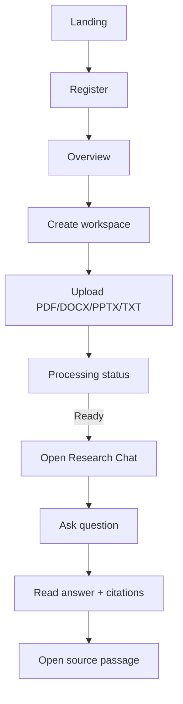
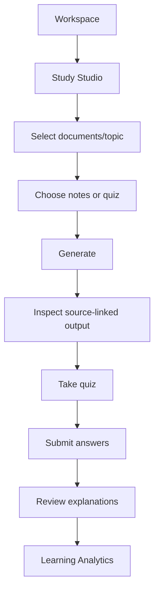
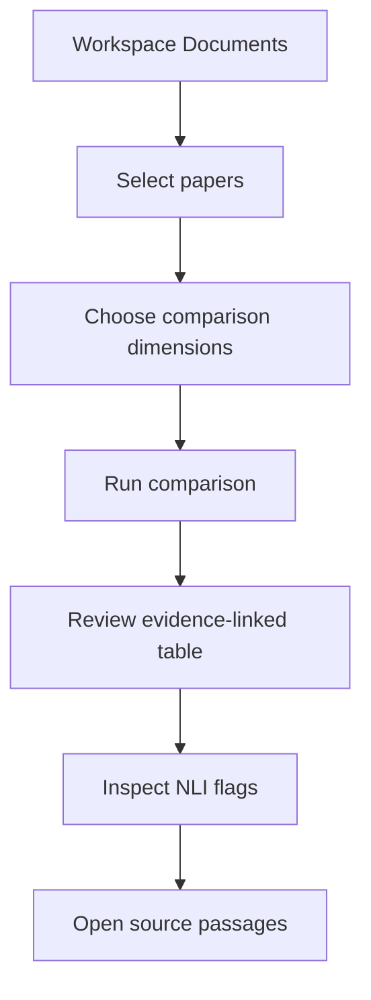

# Knovera — App Flow & User Journey

| Field | Value |
|---|---|
| Product | **Knovera** |
| Version | 1.0 |
| Status | Baseline navigation and interaction specification |
| Last updated | 5 November 2026 |
| Related documents | [prd.md](prd.md), [trd.md](trd.md), [design_brief.md](design_brief.md) |

> **Purpose:** Define routes, screen responsibilities, navigation, user actions, redirects, and loading/empty/error states. Every primary button must have a defined behaviour. Do not add routes or actions outside this flow without an approved product change.

---

## 1. Application structure

Knovera has two areas:

1. **Public/authentication area:** landing/entry page, registration, and login.
2. **Authenticated application:** overview, workspaces, documents, chat, knowledge, study, research, learning analytics, and settings.

Navigation is workspace-centric. Most knowledge actions require an active workspace so that source scope and data ownership are explicit.

### 1.1 Primary navigation

| Item | Destination | Purpose |
|---|---|---|
| Overview | `/app` | Personal overview and recent workspace activity |
| Workspaces | `/app/workspaces` | List and create workspaces |
| Documents | `/app/workspaces/:workspaceId/documents` | Browse, upload, filter, and manage sources |
| Topic Explorer | `/app/workspaces/:workspaceId/topics` | Explore discovered semantic clusters, keywords, and topics |
| Knowledge Graph | `/app/workspaces/:workspaceId/knowledge-graph` | Interactive concept network, multi-hop paths, and verified source evidence |
| Research Chat | `/app/workspaces/:workspaceId/chat` | Ask questions across workspace documents |
| Study Studio | `/app/workspaces/:workspaceId/study` | Notes, question sets, flashcards, quizzes |
| Research Intelligence | `/app/workspaces/:workspaceId/research` | Compare papers and inspect corpus coverage |
| Learning Analytics | `/app/workspaces/:workspaceId/learning` | Mastery estimates, quiz history, recommendations |
| Settings | `/app/settings` | Account and application preferences |

Hide navigation items until their implementation phase or mark them clearly as unavailable. A visible disabled item must not imply that a feature works.

---

## 2. Route inventory

| Route | Access | Screen | Purpose |
|---|---|---|---|
| `/` | Public | Landing | Explain Knovera; route to login/register |
| `/login` | Public; authenticated users redirected | Login | Authenticate existing user |
| `/register` | Public; authenticated users redirected | Registration | Create account |
| `/app` | Authenticated | Overview | Recent activity, workspace shortcuts, onboarding |
| `/app/workspaces` | Authenticated | Workspace list | Create/open/rename/delete personal workspaces |
| `/app/workspaces/:workspaceId` | Authenticated + owner | Workspace overview | Workspace summary and quick actions |
| `/app/workspaces/:workspaceId/documents` | Authenticated + owner | Document library | Upload and manage sources |
| `/app/workspaces/:workspaceId/documents/:documentId` | Authenticated + owner | Document details | Processing status and source preview |
| `/app/workspaces/:workspaceId/topics` | Authenticated + owner | Topic explorer | Discovered semantic clusters and themes |
| `/app/workspaces/:workspaceId/topics/:topicId` | Authenticated + owner | Topic detail | Keyword cloud and assigned chunk provenance |
| `/app/workspaces/:workspaceId/chat` | Authenticated + owner | New conversation | Start a workspace chat |
| `/app/workspaces/:workspaceId/chat/:conversationId` | Authenticated + owner | Conversation | Continue history and inspect citations |
| `/app/workspaces/:workspaceId/knowledge` | Authenticated + owner | Knowledge explorer | Topic list and graph |
| `/app/workspaces/:workspaceId/knowledge/concepts/:conceptId` | Authenticated + owner | Concept detail | Evidence and relationships |
| `/app/workspaces/:workspaceId/study` | Authenticated + owner | Study studio | Notes/questions/flashcards/quizzes |
| `/app/workspaces/:workspaceId/study/quizzes/:quizId` | Authenticated + owner | Quiz session | Answer and submit questions |
| `/app/workspaces/:workspaceId/research` | Authenticated + owner | Research intelligence | Select and compare documents |
| `/app/workspaces/:workspaceId/learning` | Authenticated + owner | Learning analytics | Progress, mastery estimates, recommendations |
| `/app/settings` | Authenticated | Settings | Account and preferences |
| `*` | Any | Not found | Explain missing route and offer safe navigation |

### 2.1 Route guard behaviour

- Unauthenticated user requests protected route → redirect to `/login`, preserving the intended **local** path as a safe post-login destination.
- Authenticated user opens `/login` or `/register` → redirect to `/app`.
- User requests a workspace they do not own → show a generic not-found/unauthorised state without confirming another user's workspace exists.
- Invalid document/conversation/concept ID → show not found within the current workspace.
- Deferred feature route → do not render a fake empty dashboard; hide the nav item or show a clearly labelled unavailable state.
- Redirect targets must be internal/local only; reject arbitrary URLs.

---

## 3. Entry and authentication journeys

### 3.1 First-time visitor

1. Visitor opens `/`.
2. Landing explains the product and shows **Create account** and **Log in** actions.
3. **Create account** navigates to `/register`.
4. Registration validates email/password, submits to `POST /api/v1/auth/register`, and handles duplicate email/validation errors.
5. Baseline preference: successful registration returns an authenticated session and redirects to `/app`. If the backend contract is changed to require a separate login, update this document and keep the behaviour consistent.
6. `/app` shows onboarding empty state and **Create workspace** as primary action.

### 3.2 Returning user

1. User opens `/login`.
2. Enters email and password.
3. Submits login.
4. On success, establish session using the configured secure cookie/token flow.
5. Redirect to the intended safe local path, otherwise `/app`.
6. On failure, show a generic credential error; do not disclose whether an email is registered.

### 3.3 Logout

1. User opens account/profile menu.
2. Selects **Log out**.
3. Frontend calls `POST /api/v1/auth/logout`.
4. Clear client session/query caches and redirect to `/login`.
5. If logout API fails, clear local UI state but warn that server-side revocation could not be confirmed. Do not claim revocation succeeded.

---

## 4. Overview and workspace flow

### 4.1 Overview `/app`

Display:
- Welcome heading and concise product context.
- Recent workspaces, if any.
- Recent documents/processing activity, if any.
- Quick action to create/open a workspace.
- Learning/research summary only when real underlying data exists.

Empty state:
- Explain that workspaces organise documents and conversations.
- Primary action: **Create workspace**.
- Secondary help action only when real help content exists.

### 4.2 Create workspace

1. User selects **Create workspace**.
2. Modal/drawer requests workspace name and optional description.
3. Client validates non-empty name and reasonable length.
4. Submit `POST /api/v1/workspaces`.
5. On success, invalidate workspace queries and navigate to `/app/workspaces/:workspaceId`.
6. On validation/network failure, preserve entered values and show an actionable error.

### 4.3 Workspace overview

Show workspace name, description, real API-derived counts, and quick actions:
- **Upload documents** → documents page with upload panel open.
- **Ask a question** → new chat.
- **Explore topics** → knowledge page, only after feature exists.
- **Create study material** → study page, only after feature exists.

Rename opens an edit form. Delete requires confirmation explaining that documents, chats, and derived workspace data will be removed. Deletion is not reversible unless a separate restore feature is implemented.

---

## 5. Document upload and processing journey

### 5.1 Document library

Route: `/app/workspaces/:workspaceId/documents`

Screen elements:
- Workspace breadcrumb.
- Upload button/dropzone.
- Search and filters (file type, status, date where supported).
- Document list with filename, type, size, upload date, status, and actions.
- Empty state for no documents.

### 5.2 Upload interaction

1. User selects or drops files.
2. Client checks basic extension/size for immediate feedback; server remains authoritative.
3. User confirms upload to the current workspace.
4. Frontend sends multipart request to `POST /api/v1/workspaces/{workspaceId}/documents`.
5. Server validates ownership, type, size, signature where possible, and creates document/job records.
6. UI shows upload progress, then processing status.
7. States: `queued` → `extracting` → `chunking` → `indexing` → `ready`, or `failed`.
8. A ready document can be opened or selected for chat.
9. A failed document shows a safe error explanation and **Retry** if supported.

### 5.3 Processing states

| State | UI treatment | Allowed actions |
|---|---|---|
| Queued | Neutral status and queued message | View details; cancel only if implemented |
| Extracting | Progress indicator and stage label | View details |
| Chunking | Progress indicator | View details |
| Indexing | Progress indicator | View details |
| Ready | Success status | Open, select for chat, delete |
| Failed | Error status and safe summary | Retry, inspect details, delete |

Do not display a fabricated percentage when the backend does not provide meaningful progress. Use indeterminate progress for stage-only status.

### 5.4 Document detail

Display original filename, format, size, upload date, page/slide count if known, processing status, extraction summary, and source preview when available.

- Open at the cited page/slide where possible.
- If a format cannot provide reliable pagination, display the best source location available (section/paragraph/slide) and label it accurately.
- Never invent page numbers for DOCX/TXT content.

### 5.5 Delete document

1. User selects delete.
2. Confirmation names the document and explains indexed content/derived links will be removed.
3. Submit `DELETE /api/v1/documents/{documentId}`.
4. Backend makes the document non-retrievable immediately and performs cleanup.
5. UI removes the document only after success or shows an explicit pending-deletion state.
6. If cleanup partially fails, show a retryable state; never report full deletion while vectors remain queryable.

---

## 6. Research chat journey

### 6.1 Start a new conversation

Route: `/app/workspaces/:workspaceId/chat`

Screen elements:
- Workspace context label.
- Source scope selector: all ready documents or selected subset.
- Conversation history when available.
- Empty prompt area with examples that do not imply unavailable capabilities.
- Message composer and send action.

Action:
1. User selects source scope.
2. Enters a question.
3. Send is disabled for empty input and while the request is pending.
4. Frontend creates a conversation if needed, then submits the message.
5. Backend retrieves only authorised chunks in selected workspace/scope.
6. UI shows a loading state indicating source search.
7. Answer appears with validated citation markers and any limitation/insufficient-evidence note.

### 6.2 Citation interaction

1. User selects a citation marker.
2. Frontend calls `GET /api/v1/citations/{citationId}` or uses a previously validated citation payload.
3. Open a right-side source panel or modal.
4. Show document name, page/slide/section, quoted passage, and a source-preview action.
5. If source was deleted or access is no longer valid, show “Source unavailable” and do not show stale private content.

### 6.3 Answer states

| Condition | Behaviour |
|---|---|
| Supported answer | Display answer and validated citations |
| Partial evidence | Qualify answer and identify what is not established |
| No useful evidence | Say selected documents do not contain enough evidence; suggest changing source scope or wording |
| Retrieval/provider timeout | Keep question and offer retry; avoid duplicate assistant messages |
| Provider quota/error | Show neutral service-unavailable message; hide provider secrets/stack trace |
| Invalid/deleted source | Do not render stale content; report source unavailable |
| Unsafe document instruction | Treat it as document content, not a system instruction |

### 6.4 Conversation history

- List conversations by recent activity.
- Open by route ID.
- Rename/delete only if the API supports it; deletion requires confirmation.
- Historical citation references must be resolved through current authorisation before showing source content.

---

## 7. Knowledge Graph journey

Route: `/app/workspaces/:workspaceId/knowledge-graph`

Entry requirements: at least one ready document and an active or historical knowledge graph snapshot. Otherwise show an empty state explaining how to upload documents or start discovery.

Screen elements:
- Top PageHeader with workspace breadcrumbs, snapshot version selector (Active vs Historical read-only), and Path Finder trigger button.
- Summary statistics ribbon (Total nodes, concepts, entities, relationships, connected components, density, isolated nodes, ontology version).
- Interactive controls bar:
  - Server-backed autocomplete search for concepts and entities.
  - Multi-dimensional filters: Concepts toggle, Entities toggle, Category selector, Predicate selector, and Min Confidence slider.
  - Viewport toolbar: Zoom in/out, fit to screen, reset, layout algorithm selector (COSE force-directed, concentric, breadth-first, grid), and 1-hop incremental neighborhood expansion.
- Full-bleed Cytoscape.js interactive canvas with category-based styling (Concepts in violet `#8b5cf6`, Entities in teal `#14b8a6`, algorithm `#3b82f6`, model `#8b5cf6`, dataset `#f59e0b`, technology `#06b6d4`, language `#10b981`, metric `#ec4899`, org `#6366f1`, person `#f43f5e`), directed curved bezier edges, hover glows, and selection aura.
- Slide-over detail drawers:
  - **Selected Node Drawer**: Canonical name, category, description, surface form aliases, degree metrics, connected relationships list with click-to-jump, and verified source document mentions with direct links (`page`, `slide`, `section`, `chunk_id`).
  - **Selected Relationship Drawer**: Subject -> Predicate -> Object triple, confidence score, polarity, modality, and supporting source evidence cards with verified character offsets and direct links to source documents.
- **Knowledge Path Explorer Modal**: Form to select Source and Target concepts, configurable max hops (1–4), and directed/undirected traversal. Renders discovered reasoning chains step-by-step with an action to highlight the entire path directly on the Cytoscape canvas.

Interactions:
- Click node → centers node, opens Node Details drawer with connections and source mentions.
- Click edge → highlights edge, opens Relationship Details drawer with supporting evidence snippets.
- Click canvas background → dismisses drawers and clears focus highlights.
- Select neighbor in drawer → centers and focuses that node.
- Expand Neighbors → performs bounded BFS traversal and seamlessly merges 1-hop connected nodes and edges into the canvas.
- Switch snapshot → seamlessly loads historical snapshots in read-only mode with informational banner.
- Click "Open in Document" → navigates to canonical Document Detail view with exact location parameters (`?page=...&chunk_id=...`).

---

## 8. Study Studio journey

Route: `/app/workspaces/:workspaceId/study`

Sections: revision notes, MCQs, fill-in-the-blanks, true/false, flashcards, and quiz history.

Create-material flow:
1. Select document/topic scope.
2. Choose material type and amount/difficulty if supported.
3. Select **Generate**.
4. Backend retrieves source evidence and generates structured output.
5. UI displays content and source references.
6. Save or start a quiz where supported.

Quiz flow:
1. Open quiz session.
2. Render question and answer controls with progress.
3. User selects answers and moves through the quiz.
4. Submit once; duplicate submissions are prevented.
5. Show score, correct answer, explanation, and source reference.
6. Store attempt and update learning analytics when implemented.

States:
- No ready sources → prompt upload.
- Generation pending → loading state.
- Generation failed → retry, preserving selected scope.
- No questions returned → safe error; do not create an empty quiz.
- Insufficient BKT data → show quiz history without a mastery claim.

---

## 9. Research Intelligence journey

Route: `/app/workspaces/:workspaceId/research`

1. User selects two or more ready documents.
2. Chooses comparison dimensions: objectives, methodology, datasets, evaluation, findings, stated limitations.
3. Submits comparison.
4. Backend retrieves evidence per document and constructs a source-linked comparison.
5. UI renders a comparison table with citation controls.
6. Missing information is shown as “Not stated in selected source(s).”
7. NLI indicators may flag supported, unclear, or contradictory claim/evidence pairs.
8. User can inspect source passages.

Coverage analysis:
- User selects document scope and starts corpus coverage analysis.
- Result shows under-represented, isolated, or missing topics relative to selected documents.
- Persistent notice: **“This analysis describes coverage in your uploaded documents; it does not establish a gap in all published research.”**

---

## 10. Learning Analytics journey

Route: `/app/workspaces/:workspaceId/learning`

Display only real metrics:
- Quiz attempts and recent scores.
- Concepts with sufficient observations for mastery estimates.
- Recommended concepts to revisit and why.
- Progress history over time.

Rules:
- Show observation count and plain-language explanation with BKT estimates.
- Do not show 0%/100% mastery for concepts with no attempts.
- Mark recommendations “insufficient data” when evidence is sparse.
- Let users open a recommended concept's sources or start practice.

---

## 11. Settings journey

Route: `/app/settings`

MVP sections:
- Account email and display name.
- Password change only when implemented.
- Theme preference: system/dark/light.
- Session logout.
- Data deletion/export information and privacy notice.

Do not show non-functional controls for email notifications, integrations, billing, team members, or API keys.

---

## 12. Global states and interaction rules

### Loading
- Use skeletons for stable page structures.
- Use inline spinners for local actions.
- Use indeterminate progress when no meaningful percentage is available.
- Disable duplicate submissions while pending.

### Empty
Every major list/tool needs an empty state explaining what is missing and giving one next action. Empty is not an error.

### Error
- Use clear human-readable messages.
- Preserve user-entered text on recoverable failures.
- Provide request ID where useful.
- Never expose stack traces or secrets.
- Distinguish validation, authorization, not-found, rate-limit, provider, and network errors.

### Success
Show confirmation for creation, save, retry, and deletion. Do not claim a background task is complete before the backend reports a terminal state.

### Navigation safety
- Redirects must be internal/local only.
- Browser back/forward navigation must preserve sensible state.
- Switching workspaces invalidates workspace-scoped caches/selections.
- Logout clears private client cache.

---

## 13. Critical end-to-end journeys

### Journey A — First useful answer

### Journey B — Build study resources

### Journey C — Research comparison

---

## 14. App-flow acceptance checklist

- [ ] Every route has an access rule.
- [ ] Protected routes redirect unauthenticated users safely.
- [ ] Workspace routes enforce owner access on the server.
- [ ] Every primary button has a defined API call or navigation action.
- [ ] Upload and ingestion states are explicit.
- [ ] Citations open the correct authorised evidence.
- [ ] Empty/loading/success/error states are defined for primary flows.
- [ ] Deferred capabilities are hidden or clearly marked unavailable.
- [ ] Workspace switching/logout clears private client state.
- [ ] Destructive actions require confirmation and explain consequences.
