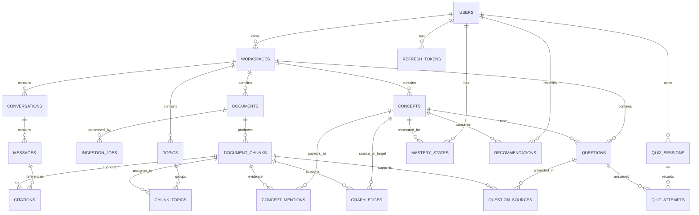

# Knovera — Backend & Database Schema

| Field | Value |
|---|---|
| Product | **Knovera** |
| Version | 1.0 |
| Status | Logical baseline; physical migrations created phase by phase |
| Last updated | 5 November 2026 |
| Relational database | PostgreSQL |
| Vector index | ChromaDB |

> **Purpose:** Define the authoritative relational model, relationships, ownership boundaries, security policies, vector metadata, and API surface. PostgreSQL is the source of truth. Do not create a parallel schema in ChromaDB.

---

## 1. Data architecture principles

1. PostgreSQL is the system of record for users, workspaces, documents, chunks, conversations, citations, study activity, graph entities, jobs, and model metadata.
2. ChromaDB is a rebuildable vector index, not the authority for ownership or document content.
3. Original binary files are stored through a storage adapter. PostgreSQL stores a generated storage key, not a public file URL.
4. IDs use UUID unless a strong reason requires another type.
5. Timestamps use `TIMESTAMPTZ` in UTC.
6. Every workspace-owned record must be attributable to one workspace and its owner.
7. Application authorisation is mandatory; PostgreSQL RLS is defence in depth.
8. Deletion explicitly invalidates derived records, vectors, caches, and graph relationships.
9. Foreign keys and constraints prevent orphaned and cross-workspace references.
10. Model/pipeline versions are recorded wherever results depend on a model or configuration.

### 1.1 Ownership model

MVP supports one owner per workspace. A user can own multiple workspaces. Team membership and collaboration are deferred.



---

## 2. Naming and type conventions

- Tables/columns use `snake_case`; table names are plural.
- Primary key: `id UUID PRIMARY KEY DEFAULT gen_random_uuid()`.
- Foreign key: `<entity>_id UUID NOT NULL`, unless optional by definition.
- Timestamps: `created_at TIMESTAMPTZ NOT NULL DEFAULT now()` and `updated_at TIMESTAMPTZ NOT NULL DEFAULT now()`.
- Flexible settings/metrics use `JSONB` only when the structure is genuinely variable.
- Counts/sizes are integer or bigint with non-negative checks.
- Probabilities/confidence use `DOUBLE PRECISION` with range checks `[0,1]`.
- Prefer check constraints for statuses if migration flexibility matters.
- Add indexes for measured query patterns; do not index every column speculatively.

---

## 3. Core identity and workspace tables

### 3.1 `users`

| Column | Type | Constraints / purpose |
|---|---|---|
| `id` | UUID | PK |
| `email` | CITEXT or normalized VARCHAR(320) | NOT NULL, UNIQUE; normalized lowercase address |
| `password_hash` | TEXT | NOT NULL; Argon2id encoded hash |
| `display_name` | VARCHAR(120) | Nullable initially |
| `status` | VARCHAR(20) | NOT NULL; `active`, `disabled`, `pending` |
| `created_at` | TIMESTAMPTZ | NOT NULL |
| `updated_at` | TIMESTAMPTZ | NOT NULL |
| `last_login_at` | TIMESTAMPTZ | Nullable |

Rules: never store plaintext/reversibly encrypted passwords; normalize email consistently; never return `password_hash` in APIs. Index: unique normalized email.

### 3.2 `refresh_tokens`

| Column | Type | Constraints / purpose |
|---|---|---|
| `id` | UUID | PK |
| `user_id` | UUID | FK → `users.id`, NOT NULL, ON DELETE CASCADE |
| `token_hash` | TEXT | NOT NULL, UNIQUE; hash of opaque refresh token |
| `token_family_id` | UUID | NOT NULL; rotation/reuse detection group |
| `created_at` | TIMESTAMPTZ | NOT NULL |
| `expires_at` | TIMESTAMPTZ | NOT NULL |
| `revoked_at` | TIMESTAMPTZ | Nullable |
| `replaced_by_id` | UUID | Nullable FK → `refresh_tokens.id` |
| `user_agent_summary` | VARCHAR(300) | Nullable; avoid excessive fingerprinting |

Indexes: `(user_id, expires_at)`, `(token_family_id)`, unique `token_hash`.

### 3.3 `workspaces`

| Column | Type | Constraints / purpose |
|---|---|---|
| `id` | UUID | PK |
| `owner_user_id` | UUID | FK → `users.id`, NOT NULL, ON DELETE CASCADE |
| `name` | VARCHAR(120) | NOT NULL |
| `description` | TEXT | Nullable |
| `created_at` | TIMESTAMPTZ | NOT NULL |
| `updated_at` | TIMESTAMPTZ | NOT NULL |

Index: `(owner_user_id, updated_at DESC)`. MVP has no `workspace_members` table; do not imply shared access.

---

## 4. Document ingestion tables

### 4.1 `documents`

| Column | Type | Constraints / purpose |
|---|---|---|
| `id` | UUID | PK |
| `workspace_id` | UUID | FK → `workspaces.id`, NOT NULL, ON DELETE CASCADE |
| `uploaded_by_user_id` | UUID | FK → `users.id`, NOT NULL |
| `original_filename` | VARCHAR(512) | NOT NULL; display only, never a path |
| `storage_key` | TEXT | NOT NULL, UNIQUE; generated key |
| `media_type` | VARCHAR(150) | NOT NULL |
| `file_extension` | VARCHAR(20) | NOT NULL |
| `file_size_bytes` | BIGINT | NOT NULL, CHECK >= 0 |
| `sha256` | CHAR(64) | NOT NULL; integrity/duplicate detection |
| `processing_status` | VARCHAR(20) | `queued`, `extracting`, `chunking`, `indexing`, `ready`, `failed`, `deleting` |
| `processing_stage` | VARCHAR(40) | Nullable |
| `page_count` | INTEGER | Nullable, CHECK >= 0 (PDF) |
| `slide_count` | INTEGER | Nullable, CHECK >= 0 (PPTX) |
| `extracted_block_count` | INTEGER | Nullable, CHECK >= 0 |
| `total_characters` | BIGINT | Nullable, CHECK >= 0 |
| `chunk_count` | INTEGER | Nullable, CHECK >= 0 |
| `pipeline_version` | VARCHAR(50) | NOT NULL DEFAULT 'v1.0' |
| `extraction_metadata` | JSONB | NOT NULL DEFAULT `{}`; parser/version/warnings, no secrets |
| `error_code` | VARCHAR(80) | Nullable |
| `error_summary` | TEXT | Nullable, safe for display |
| `created_at` | TIMESTAMPTZ | NOT NULL |
| `updated_at` | TIMESTAMPTZ | NOT NULL |
| `deleted_at` | TIMESTAMPTZ | Nullable; controlled cleanup/soft-delete state |

Indexes and Constraints:
- Unique Partial Index: `uq_documents_workspace_sha256_active` on `(workspace_id, sha256)` WHERE `deleted_at IS NULL`.
- Indexes: `(workspace_id, created_at DESC)`, `(workspace_id, processing_status)`, `(workspace_id, sha256)`.

### 4.2 `document_pages`

| Column | Type | Constraints / purpose |
|---|---|---|
| `id` | UUID | PK |
| `document_id` | UUID | FK → `documents.id`, NOT NULL, ON DELETE CASCADE |
| `page_number` | INTEGER | NOT NULL, 1-based page index (CHECK > 0) |
| `text_content` | TEXT | NOT NULL; raw extracted page text |
| `char_count` | INTEGER | NOT NULL DEFAULT 0, CHECK >= 0 |
| `has_images` | BOOLEAN | NOT NULL DEFAULT false |
| `is_empty` | BOOLEAN | NOT NULL DEFAULT false |
| `metadata_json` | JSONB | NOT NULL DEFAULT `{}` |
| `created_at` | TIMESTAMPTZ | NOT NULL |

Constraints/indexes:
- Unique `(document_id, page_number)`.
- Index `(document_id, page_number)`.

### 4.3 `document_chunks`

| Column | Type | Constraints / purpose |
|---|---|---|
| `id` | UUID | PK; deterministic UUID5 based on document, version, index, and hash |
| `workspace_id` | UUID | FK → `workspaces.id`, NOT NULL |
| `document_id` | UUID | FK → `documents.id`, NOT NULL, ON DELETE CASCADE |
| `chunk_index` | INTEGER | NOT NULL, CHECK >= 0 |
| `content` | TEXT | NOT NULL; authoritative cleaned chunk text |
| `content_hash` | CHAR(64) | NOT NULL (SHA-256) |
| `page_start` | INTEGER | Nullable; 1-based where available (PDF) |
| `page_end` | INTEGER | Nullable; >= page_start when both set (PDF) |
| `slide_number` | INTEGER | Nullable; 1-based for PPTX |
| `section_title` | TEXT | Nullable; Section or heading context |
| `source_start_offset` | BIGINT | Nullable |
| `source_end_offset` | BIGINT | Nullable |
| `token_count` | INTEGER | Nullable, CHECK >= 0 |
| `token_count_method` | VARCHAR(50) | Nullable; e.g. `estimate_v1` |
| `parser_version` | VARCHAR(100) | NOT NULL |
| `cleaning_version` | VARCHAR(100) | NOT NULL |
| `chunking_version` | VARCHAR(100) | NOT NULL; e.g. `semantic-v1` |
| `source_segments` | JSONB | Nullable; list of contributing source segments with coordinates |
| `created_at` | TIMESTAMPTZ | NOT NULL |

Constraints/indexes:
- Unique `(document_id, chunk_index, chunking_version)`.
- Index `(workspace_id, document_id)`.
- Index `(document_id, chunking_version)`.
- Index `(document_id, page_start)`.

### 4.3 `ingestion_jobs`

| Column | Type | Constraints / purpose |
|---|---|---|
| `id` | UUID | PK |
| `workspace_id` | UUID | FK → `workspaces.id`, NOT NULL |
| `document_id` | UUID | FK → `documents.id`, NOT NULL, ON DELETE CASCADE |
| `job_type` | VARCHAR(40) | `document_ingestion`, `reindex`, etc. |
| `status` | VARCHAR(20) | `queued`, `running`, `retry_wait`, `completed`, `failed`, `cancelled` |
| `stage` | VARCHAR(40) | Nullable |
| `attempt_count` | INTEGER | NOT NULL DEFAULT 0, CHECK >= 0 |
| `max_attempts` | INTEGER | NOT NULL DEFAULT 3, CHECK > 0 |
| `available_at` | TIMESTAMPTZ | NOT NULL DEFAULT now() |
| `locked_at` | TIMESTAMPTZ | Nullable |
| `locked_by` | VARCHAR(120) | Nullable worker ID |
| `last_error_code` | VARCHAR(80) | Nullable |
| `last_error_summary` | TEXT | Nullable, sanitised |
| `created_at` | TIMESTAMPTZ | NOT NULL |
| `updated_at` | TIMESTAMPTZ | NOT NULL |
| `completed_at` | TIMESTAMPTZ | Nullable |

Indexes: `(status, available_at)`, `(document_id, created_at DESC)`. Claim jobs transactionally (e.g. `FOR UPDATE SKIP LOCKED`) to avoid duplicate workers.

---

## 5. Conversation and citation tables

### 5.1 `conversations`

| Column | Type | Constraints / purpose |
|---|---|---|
| `id` | UUID | PK |
| `workspace_id` | UUID | FK → `workspaces.id`, NOT NULL, ON DELETE CASCADE |
| `created_by_user_id` | UUID | FK → `users.id`, NOT NULL |
| `title` | VARCHAR(200) | NOT NULL |
| `source_scope` | JSONB | NOT NULL DEFAULT `{}`; selected document IDs/filter snapshot |
| `created_at` | TIMESTAMPTZ | NOT NULL |
| `updated_at` | TIMESTAMPTZ | NOT NULL |

Index: `(workspace_id, updated_at DESC)`.

### 5.2 `messages`

| Column | Type | Constraints / purpose |
|---|---|---|
| `id` | UUID | PK |
| `workspace_id` | UUID | FK → `workspaces.id`, NOT NULL; supports boundary checks |
| `conversation_id` | UUID | FK → `conversations.id`, NOT NULL, ON DELETE CASCADE |
| `role` | VARCHAR(20) | `user` or `assistant`, CHECK role IN ('user', 'assistant') |
| `content` | TEXT | NOT NULL |
| `status` | VARCHAR(20) | `complete`, `pending`, `failed`, CHECK status IN ('complete', 'pending', 'failed') |
| `client_request_id` | VARCHAR(120) | Nullable; client idempotency key |
| `in_reply_to_message_id` | UUID | Nullable FK → `messages.id` (self-referential) |
| `model_provider` | VARCHAR(80) | Nullable; e.g. `mock`, `gemini`, `groq`, `openai_compatible` |
| `model_name` | VARCHAR(160) | Nullable; model identifier snapshot |
| `retrieval_metadata` | JSONB | NOT NULL DEFAULT `{}`; telemetry, metrics, token counts, source mapping |
| `latency_ms` | INTEGER | Nullable, CHECK latency_ms >= 0 |
| `failure_code` | VARCHAR(80) | Nullable; error categorization if failed |
| `created_at` | TIMESTAMPTZ | NOT NULL |

Indexes:
- `ix_messages_conversation_created` on `(conversation_id, created_at)`
- `ix_messages_workspace_created` on `(workspace_id, created_at DESC)`
- `uq_messages_conversation_client_req` UNIQUE partial index on `(conversation_id, client_request_id) WHERE client_request_id IS NOT NULL`
- `ix_messages_in_reply_to` on `(in_reply_to_message_id)`

### 5.3 `citations`

| Column | Type | Constraints / purpose |
|---|---|---|
| `id` | UUID | PK |
| `workspace_id` | UUID | FK → `workspaces.id`, NOT NULL |
| `message_id` | UUID | FK → `messages.id`, NOT NULL, ON DELETE CASCADE |
| `chunk_id` | UUID | FK → `document_chunks.id`, NOT NULL; controlled deletion handling |
| `claim_index` | INTEGER | Nullable; answer claim index |
| `display_order` | INTEGER | NOT NULL DEFAULT 0 |
| `quote_text` | TEXT | Nullable; if stored, must exactly match referenced chunk excerpt |
| `relevance_score` | DOUBLE PRECISION | Nullable; constrain to 0–1 if normalised |
| `created_at` | TIMESTAMPTZ | NOT NULL |

Validation rules:
- Citation workspace must match message and chunk workspace.
- Citation chunk must have been part of the authorised retrieval context for that answer.
- Validate IDs before response and when opening historical citations.
- Do not store generated quotes unless verified against chunk text.

---

## 6. Topics, concepts, and graph tables

### 6.1 `topic_clustering_runs` (Phase 6 C6.6)

| Column | Type | Constraints / purpose |
|---|---|---|
| `id` | UUID | PK |
| `workspace_id` | UUID | FK → `workspaces.id`, NOT NULL, ON DELETE CASCADE |
| `snapshot_id` | VARCHAR(100) | NOT NULL, snapshot identifier |
| `status` | VARCHAR(30) | NOT NULL, default `'queued'` (`queued`, `running`, `completed`, `failed`) |
| `algorithm` | VARCHAR(50) | NOT NULL, default `'kmeans'` |
| `model_version` | VARCHAR(100) | NOT NULL |
| `embedding_model_id` | VARCHAR(150) | NOT NULL |
| `embedding_dimension` | INTEGER | NOT NULL |
| `k` | INTEGER | NOT NULL |
| `configuration` | JSONB | NOT NULL DEFAULT `{}` |
| `evaluation_metrics` | JSONB | NOT NULL DEFAULT `{}` |
| `selection_metadata` | JSONB | NOT NULL DEFAULT `{}` |
| `model_artifact_path` | VARCHAR(512) | Nullable |
| `corpus_snapshot_hash` | VARCHAR(64) | NOT NULL, SHA-256 |
| `created_by_user_id` | UUID | FK → `users.id`, Nullable, ON DELETE SET NULL |
| `created_at` | TIMESTAMPTZ | NOT NULL, DEFAULT `now()` |
| `started_at` | TIMESTAMPTZ | Nullable |
| `completed_at` | TIMESTAMPTZ | Nullable |
| `is_active` | BOOLEAN | NOT NULL, DEFAULT `false` |

Indexes: `(workspace_id, created_at)`, `(workspace_id, is_active)`.

### 6.2 `topics` (Phase 6 C6.6)

| Column | Type | Constraints / purpose |
|---|---|---|
| `id` | UUID | PK |
| `workspace_id` | UUID | FK → `workspaces.id`, NOT NULL, ON DELETE CASCADE |
| `clustering_run_id` | UUID | FK → `topic_clustering_runs.id`, NOT NULL, ON DELETE CASCADE |
| `cluster_key` | VARCHAR(50) | NOT NULL, e.g. `'cluster_0'` |
| `label` | VARCHAR(255) | NOT NULL |
| `description` | TEXT | Nullable |
| `label_source` | VARCHAR(50) | NOT NULL, default `'keyword_based'` (`keyword_based`, `llm_assisted`, `human_reviewed`) |
| `label_status` | VARCHAR(50) | NOT NULL, default `'suggested'` (`suggested`, `reviewed`, `approved`, `needs_review`) |
| `keywords` | JSONB | NOT NULL DEFAULT `[]`, ranked keyword list |
| `representative_chunk_ids` | JSONB | NOT NULL DEFAULT `[]`, top centroid representative chunk IDs |
| `cluster_statistics` | JSONB | NOT NULL DEFAULT `{}`, size, proportion, min/mean/max distances |
| `created_at` | TIMESTAMPTZ | NOT NULL, DEFAULT `now()` |
| `updated_at` | TIMESTAMPTZ | NOT NULL, DEFAULT `now()` |

Unique Constraint: `UNIQUE (clustering_run_id, cluster_key)`.

### 6.3 `topic_assignments` (Phase 6 C6.6)

| Column | Type | Constraints / purpose |
|---|---|---|
| `id` | UUID | PK |
| `workspace_id` | UUID | FK → `workspaces.id`, NOT NULL, ON DELETE CASCADE |
| `clustering_run_id` | UUID | FK → `topic_clustering_runs.id`, NOT NULL, ON DELETE CASCADE |
| `topic_id` | UUID | FK → `topics.id`, NOT NULL, ON DELETE CASCADE |
| `chunk_id` | UUID | FK → `document_chunks.id`, NOT NULL, ON DELETE CASCADE |
| `document_id` | UUID | FK → `documents.id`, NOT NULL, ON DELETE CASCADE |
| `distance_to_centroid` | DOUBLE PRECISION | Nullable, Euclidean distance to cluster centroid |
| `is_representative` | BOOLEAN | NOT NULL, DEFAULT `false` |
| `assigned_at` | TIMESTAMPTZ | NOT NULL, DEFAULT `now()` |

Unique Constraint: `UNIQUE (clustering_run_id, chunk_id)`.  
Indexes: `(workspace_id, clustering_run_id)`, `(topic_id)`, `(chunk_id)`, `(document_id)`.

### 6.4 Topic Discovery API Data Contracts (Phase 6 C6.7)

#### Topic Explorer List Envelope (`PaginatedTopicsResponse`)
```json
{
  "workspace_id": "UUID",
  "run": {
    "id": "UUID",
    "workspace_id": "UUID",
    "snapshot_id": "string",
    "status": "completed",
    "k": 4,
    "model_version": "kmeans_v1_k4",
    "is_active": true,
    "created_at": "ISO-8601",
    "completed_at": "ISO-8601"
  },
  "items": [
    {
      "id": "UUID",
      "workspace_id": "UUID",
      "clustering_run_id": "UUID",
      "cluster_key": "cluster_0",
      "label": "string",
      "description": "string",
      "label_source": "keyword_based",
      "label_status": "suggested",
      "keywords": [{"term": "string", "score": 0.85}],
      "chunk_count": 12,
      "document_count": 3,
      "representative_chunk_ids": ["UUID"],
      "created_at": "ISO-8601",
      "updated_at": "ISO-8601"
    }
  ],
  "total": 4,
  "page": 1,
  "page_size": 20,
  "total_pages": 1
}
```

#### Paginated Topic Chunks Contract (`PaginatedTopicChunksResponse`)
```json
{
  "topic_id": "UUID",
  "topic_label": "string",
  "items": [
    {
      "assignment_id": "UUID",
      "chunk_id": "UUID",
      "document_id": "UUID",
      "document_title": "string",
      "chunk_index": 0,
      "distance_to_centroid": 0.125,
      "is_representative": true,
      "page_start": 1,
      "page_end": 2,
      "slide_number": null,
      "section_title": null,
      "content_preview": "string",
      "source_type": "application/pdf"
    }
  ],
  "total": 12,
  "page": 1,
  "page_size": 20,
  "total_pages": 1
}
```

### 6.5 `knowledge_extraction_runs` (Phase 7 C7.1–C7.3)

| Column | Type | Constraints / purpose |
|---|---|---|
| `id` | UUID | PK |
| `workspace_id` | UUID | FK → `workspaces.id`, NOT NULL, ON DELETE CASCADE |
| `status` | VARCHAR(50) | NOT NULL DEFAULT `'completed'` (`pending`, `running`, `completed`, `failed`) |
| `ontology_version` | VARCHAR(20) | NOT NULL DEFAULT `'1.0.0'` |
| `extraction_method` | VARCHAR(50) | NOT NULL DEFAULT `'deterministic'` (`deterministic`, `llm`, `hybrid`) |
| `total_chunks_processed` | INTEGER | NOT NULL DEFAULT `0` |
| `total_nodes_extracted` | INTEGER | NOT NULL DEFAULT `0` |
| `total_relationships_extracted` | INTEGER | NOT NULL DEFAULT `0` |
| `statistics` | JSON | NOT NULL DEFAULT `'{}'` (timing, mention counts, error logs) |
| `error_message` | TEXT | Nullable |
| `created_at` | TIMESTAMPTZ | NOT NULL |
| `updated_at` | TIMESTAMPTZ | NOT NULL |

Index on `(workspace_id)`.

### 6.6 `knowledge_nodes` (Phase 7 C7.1–C7.2)

| Column | Type | Constraints / purpose |
|---|---|---|
| `id` | UUID | PK |
| `workspace_id` | UUID | FK → `workspaces.id`, NOT NULL, ON DELETE CASCADE |
| `extraction_run_id` | UUID | FK → `knowledge_extraction_runs.id`, Nullable, ON DELETE CASCADE |
| `node_type` | VARCHAR(50) | NOT NULL DEFAULT `'concept'` (`concept` or `entity`) |
| `category` | VARCHAR(50) | NOT NULL (from centralized ontology e.g. `algorithm`, `model`, `metric`) |
| `name` | VARCHAR(255) | NOT NULL (display title / capitalized canonical surface name) |
| `normalized_name` | VARCHAR(255) | NOT NULL (punctuation-preserving canonical key) |
| `description` | TEXT | Nullable |
| `aliases` | JSON | NOT NULL DEFAULT `'[]'` (list of discovered acronyms / synonyms) |
| `created_at` | TIMESTAMPTZ | NOT NULL |
| `updated_at` | TIMESTAMPTZ | NOT NULL |

Unique `(workspace_id, normalized_name, category)`.
Indexes on `(workspace_id)`, `(normalized_name)`, and `(workspace_id, node_type)`.

### 6.7 `knowledge_mentions` (Phase 7 C7.1)

| Column | Type | Constraints / purpose |
|---|---|---|
| `id` | UUID | PK |
| `workspace_id` | UUID | FK → `workspaces.id`, NOT NULL, ON DELETE CASCADE |
| `node_id` | UUID | FK → `knowledge_nodes.id`, NOT NULL, ON DELETE CASCADE |
| `chunk_id` | UUID | FK → `document_chunks.id`, Nullable, ON DELETE CASCADE |
| `surface_form` | VARCHAR(255) | NOT NULL |
| `start_offset` | INTEGER | NOT NULL (Unicode code point index in source chunk text) |
| `end_offset` | INTEGER | NOT NULL (Unicode code point index in source chunk text) |
| `confidence` | FLOAT | NOT NULL DEFAULT `1.0` (0.0 to 1.0) |
| `extraction_method` | VARCHAR(50) | NOT NULL DEFAULT `'deterministic'` |
| `created_at` | TIMESTAMPTZ | NOT NULL |

Indexes on `(workspace_id)`, `(node_id)`, `(chunk_id)`, and `(chunk_id, start_offset, end_offset)`.

### 6.8 `knowledge_relationships` (Phase 7 C7.3)

| Column | Type | Constraints / purpose |
|---|---|---|
| `id` | UUID | PK |
| `workspace_id` | UUID | FK → `workspaces.id`, NOT NULL, ON DELETE CASCADE |
| `extraction_run_id` | UUID | FK → `knowledge_extraction_runs.id`, Nullable, ON DELETE CASCADE |
| `source_node_id` | UUID | FK → `knowledge_nodes.id`, NOT NULL, ON DELETE CASCADE |
| `target_node_id` | UUID | FK → `knowledge_nodes.id`, NOT NULL, ON DELETE CASCADE |
| `relation_type` | VARCHAR(100) | NOT NULL (e.g. `uses`, `is_a`, `part_of`, `trained_on`) |
| `inverse_relation_type` | VARCHAR(100) | Nullable |
| `is_negated` | BOOLEAN | NOT NULL DEFAULT `FALSE` |
| `modality` | VARCHAR(50) | NOT NULL DEFAULT `'certain'` (`certain`, `hypothetical`, `uncertain`) |
| `qualifiers` | JSON | NOT NULL DEFAULT `'{}'` |
| `confidence` | FLOAT | NOT NULL DEFAULT `1.0` |
| `extraction_method` | VARCHAR(50) | NOT NULL DEFAULT `'deterministic'` |
| `validation_status` | VARCHAR(50) | NOT NULL DEFAULT `'valid'` |
| `created_at` | TIMESTAMPTZ | NOT NULL |
| `updated_at` | TIMESTAMPTZ | NOT NULL |

Unique `(workspace_id, source_node_id, target_node_id, relation_type, is_negated)`.
Indexes on `(workspace_id)`, `(source_node_id)`, `(target_node_id)`, `(relation_type)`, and `(workspace_id, source_node_id, target_node_id)`.

### 6.9 `relationship_evidence` (Phase 7 C7.3)

| Column | Type | Constraints / purpose |
|---|---|---|
| `id` | UUID | PK |
| `workspace_id` | UUID | FK → `workspaces.id`, NOT NULL, ON DELETE CASCADE |
| `relationship_id` | UUID | FK → `knowledge_relationships.id`, NOT NULL, ON DELETE CASCADE |
| `chunk_id` | UUID | FK → `document_chunks.id`, Nullable, ON DELETE CASCADE |
| `evidence_text` | TEXT | NOT NULL (exact source sentence or spanning quote) |
| `start_offset` | INTEGER | NOT NULL (verified Unicode offset in source chunk) |
| `end_offset` | INTEGER | NOT NULL (verified Unicode offset in source chunk) |
| `confidence` | FLOAT | NOT NULL DEFAULT `1.0` |
| `created_at` | TIMESTAMPTZ | NOT NULL |

Indexes on `(workspace_id)`, `(relationship_id)`, `(chunk_id)`, and `(chunk_id, start_offset, end_offset)`.

Rules:
- Both nodes and relationship edges must belong to the same workspace.
- Self-loops are rejected by default unless predicate is explicitly reflexive (e.g. `correlates_with`, `similar_to`).
- Every edge requires explicit syntactic or semantic relational evidence; mere co-occurrence is strictly rejected.
- Evidence records are aggregated when identical triples occur across multiple chunks or documents.

### 6.10 `knowledge_graph_snapshots` (Phase 7 C7.6)

| Column | Type | Constraints / purpose |
|---|---|---|
| `id` | UUID | PK |
| `workspace_id` | UUID | FK → `workspaces.id`, NOT NULL, ON DELETE CASCADE |
| `extraction_run_id` | UUID | FK → `knowledge_extraction_runs.id`, Nullable, ON DELETE SET NULL |
| `node_count` | INTEGER | NOT NULL DEFAULT `0` |
| `concept_count` | INTEGER | NOT NULL DEFAULT `0` |
| `entity_count` | INTEGER | NOT NULL DEFAULT `0` |
| `edge_count` | INTEGER | NOT NULL DEFAULT `0` |
| `isolated_node_count` | INTEGER | NOT NULL DEFAULT `0` |
| `component_count` | INTEGER | NOT NULL DEFAULT `1` |
| `graph_statistics` | JSON | NOT NULL DEFAULT `'{}'` (full topological statistics: degrees, density, self-loops, parallel edges) |
| `artifact_uri` | VARCHAR(500) | NOT NULL (relative path to `graph.json` artifact) |
| `artifact_checksum` | VARCHAR(64) | NOT NULL (SHA-256 of `graph.json` content) |
| `source_snapshot_hash` | VARCHAR(64) | Nullable (hash of source corpus state) |
| `created_by_user_id` | UUID | FK → `users.id`, Nullable, ON DELETE SET NULL |
| `status` | VARCHAR(50) | NOT NULL DEFAULT `'completed'` (`completed`, `reconstructing`, `failed`) |
| `is_active` | BOOLEAN | NOT NULL DEFAULT `TRUE` (at most one active snapshot per workspace) |
| `created_at` | TIMESTAMPTZ | NOT NULL |
| `updated_at` | TIMESTAMPTZ | NOT NULL |

Indexes:
- `(workspace_id)`
- `(workspace_id, is_active)`
- `(workspace_id, created_at)`
- Partial unique index on `(workspace_id)` where `is_active = TRUE` (enforcing single active snapshot per workspace).

Rules:
- Snapshot artifacts are immutable, versioned JSON node-link files written atomically (`.tmp` write → checksum verify → replace).
- Accompanied by a sidecar `manifest.json` preserving build environment, graph schema version, ontology version, and topological metrics.
- Multi-tenant isolation: graph construction and persistence strictly validate that all nodes and relationships belong to the specified `workspace_id`.
- Reconstructibility: in the event of missing or corrupted storage artifacts, graphs can be deterministically reconstructed from canonical PostgreSQL tables (`knowledge_nodes`, `knowledge_relationships`).

---

## 7. Study and adaptive learning tables

### 7.1 `questions`

| Column | Type | Constraints / purpose |
|---|---|---|
| `id` | UUID | PK |
| `workspace_id` | UUID | FK → `workspaces.id`, NOT NULL |
| `concept_id` | UUID | Nullable FK → `concepts.id` |
| `question_type` | VARCHAR(30) | `mcq`, `fill_blank`, `true_false`, `flashcard` |
| `question_text` | TEXT | NOT NULL |
| `options` | JSONB | Nullable; MCQ options |
| `correct_answer` | JSONB | NOT NULL; kept server-side until quiz submission |
| `explanation` | TEXT | Nullable |
| `difficulty` | VARCHAR(20) | Nullable: `easy`, `medium`, `hard` |
| `generation_model` | VARCHAR(160) | Nullable |
| `model_version` | VARCHAR(100) | Nullable |
| `created_by_user_id` | UUID | FK → `users.id`, NOT NULL |
| `created_at` | TIMESTAMPTZ | NOT NULL |

### 7.2 `question_sources`

| Column | Type | Constraints / purpose |
|---|---|---|
| `question_id` | UUID | FK → `questions.id`, ON DELETE CASCADE |
| `chunk_id` | UUID | FK → `document_chunks.id`, ON DELETE CASCADE |
| `display_order` | INTEGER | NOT NULL DEFAULT 0 |

Primary key: `(question_id, chunk_id)`.

### 7.3 `quiz_sessions`

| Column | Type | Constraints / purpose |
|---|---|---|
| `id` | UUID | PK |
| `workspace_id` | UUID | FK → `workspaces.id`, NOT NULL |
| `user_id` | UUID | FK → `users.id`, NOT NULL |
| `title` | VARCHAR(200) | Nullable |
| `status` | VARCHAR(20) | `in_progress`, `submitted`, `abandoned` |
| `question_ids` | UUID[] | NOT NULL session snapshot/order; normalise to join table if queried frequently |
| `started_at` | TIMESTAMPTZ | NOT NULL |
| `submitted_at` | TIMESTAMPTZ | Nullable |
| `created_at` | TIMESTAMPTZ | NOT NULL |

### 7.4 `quiz_attempts`

| Column | Type | Constraints / purpose |
|---|---|---|
| `id` | UUID | PK |
| `quiz_session_id` | UUID | FK → `quiz_sessions.id`, NOT NULL, ON DELETE CASCADE |
| `workspace_id` | UUID | FK → `workspaces.id`, NOT NULL |
| `user_id` | UUID | FK → `users.id`, NOT NULL |
| `question_id` | UUID | FK → `questions.id`, NOT NULL |
| `selected_answer` | JSONB | Nullable |
| `is_correct` | BOOLEAN | Nullable until graded |
| `response_time_ms` | INTEGER | Nullable, CHECK >= 0 |
| `attempt_number` | INTEGER | NOT NULL DEFAULT 1, CHECK > 0 |
| `created_at` | TIMESTAMPTZ | NOT NULL |

Unique `(quiz_session_id, question_id, attempt_number)`; index `(user_id, workspace_id, created_at DESC)`.

### 7.5 `mastery_states`

| Column | Type | Constraints / purpose |
|---|---|---|
| `id` | UUID | PK |
| `user_id` | UUID | FK → `users.id`, NOT NULL |
| `workspace_id` | UUID | FK → `workspaces.id`, NOT NULL |
| `concept_id` | UUID | FK → `concepts.id`, NOT NULL |
| `p_mastery` | DOUBLE PRECISION | NOT NULL, CHECK 0–1 |
| `attempt_count` | INTEGER | NOT NULL DEFAULT 0, CHECK >= 0 |
| `correct_count` | INTEGER | NOT NULL DEFAULT 0, CHECK 0 <= correct_count <= attempt_count |
| `p_l0` | DOUBLE PRECISION | Nullable; BKT parameter snapshot |
| `p_t` | DOUBLE PRECISION | Nullable |
| `p_g` | DOUBLE PRECISION | Nullable |
| `p_s` | DOUBLE PRECISION | Nullable |
| `model_version` | VARCHAR(100) | Nullable |
| `last_attempt_at` | TIMESTAMPTZ | Nullable |
| `updated_at` | TIMESTAMPTZ | NOT NULL |

Unique `(user_id, concept_id)`; ensure concept/workspace scope is consistent.

### 7.6 `recommendations`

| Column | Type | Constraints / purpose |
|---|---|---|
| `id` | UUID | PK |
| `user_id` | UUID | FK → `users.id`, NOT NULL |
| `workspace_id` | UUID | FK → `workspaces.id`, NOT NULL |
| `concept_id` | UUID | FK → `concepts.id`, NOT NULL |
| `reason_code` | VARCHAR(80) | NOT NULL |
| `reason_text` | TEXT | NOT NULL |
| `priority` | SMALLINT | NOT NULL, bounded scale such as 1–5 |
| `status` | VARCHAR(20) | `active`, `completed`, `dismissed`, `expired` |
| `created_at` | TIMESTAMPTZ | NOT NULL |
| `expires_at` | TIMESTAMPTZ | Nullable |

---

## 8. Model registry and audit metadata

### 8.1 `model_versions`

| Column | Type | Constraints / purpose |
|---|---|---|
| `id` | UUID | PK |
| `model_key` | VARCHAR(100) | Logical use: `embedding`, `reranker`, `intent`, `nli`, `bkt` |
| `provider` | VARCHAR(100) | NOT NULL |
| `model_name` | VARCHAR(200) | NOT NULL |
| `model_revision` | VARCHAR(160) | Nullable |
| `configuration` | JSONB | NOT NULL DEFAULT `{}`; no API keys |
| `metrics` | JSONB | NOT NULL DEFAULT `{}` |
| `is_active` | BOOLEAN | NOT NULL DEFAULT false |
| `created_at` | TIMESTAMPTZ | NOT NULL |

### 8.2 Optional `audit_events`

Add during security/operations phase. Suggested fields: `id`, `actor_user_id`, `workspace_id`, `event_type`, `resource_type`, `resource_id`, `request_id`, safe `metadata JSONB`, `created_at`. Do not store raw document contents, passwords, tokens, or full prompts by default.

---

## 9. PostgreSQL Row-Level Security (RLS)

### 9.1 Policy intent

- `users`: user can read/update only their own profile.
- `refresh_tokens`: user can inspect/revoke only their sessions; trusted service role may manage sessions.
- `workspaces`: `owner_user_id` must equal authenticated transaction-local user ID.
- Child workspace tables (`documents`, `document_chunks`, `ingestion_jobs`, `conversations`, `messages`, `citations`, `topics`, `concepts`, graph and study tables): access only if `workspace_id` resolves to a workspace owned by transaction-local user.

### 9.2 Example policy pattern

```sql
-- Set only by trusted backend code inside the transaction:
SET LOCAL app.user_id = '00000000-0000-0000-0000-000000000000';

ALTER TABLE workspaces ENABLE ROW LEVEL SECURITY;
ALTER TABLE workspaces FORCE ROW LEVEL SECURITY;

CREATE POLICY workspace_owner_policy ON workspaces
USING (owner_user_id = NULLIF(current_setting('app.user_id', true), '')::uuid)
WITH CHECK (owner_user_id = NULLIF(current_setting('app.user_id', true), '')::uuid);
```

For child tables, policy uses `EXISTS` against `workspaces` where `workspaces.id = child.workspace_id` and `owner_user_id` equals the transaction-local user. Validate exact policy behaviour in integration tests.

### 9.3 Implementation rules

- Set user context using `SET LOCAL` in the same transaction, not a connection-level setting that can leak through the pool.
- Never accept `app.user_id` from a client request.
- Worker/service credentials are isolated, limited, and never exposed to the frontend.
- Avoid recursive policies or grants through user-controlled workspace IDs.
- Test positive and negative cases with separate users and pooled connections.

---

## 10. ChromaDB collection and metadata design

Use a deterministic collection strategy that isolates incompatible embedding dimensions and model versions (implemented in Phase 3 C3.2):

`knovera_chunks_{model_part}_{dimension}` (e.g. `knovera_chunks_all-MiniLM-L6-v2_384`)

Collection distance space: `hnsw:space: "cosine"`.

Each vector record in ChromaDB:

| Chroma field | Value | Type / Notes |
|---|---|---|
| `id` | `document_chunks.id` as stable string UUID | Stable UUID5 for idempotency |
| `embedding` | Normalized dense vector | 384-dimensional float vector ($L_2$ norm = 1.0) |
| `metadata.chunk_id` | Chunk UUID string | Authoritative identifier |
| `metadata.document_id` | Document UUID string | Parent document filter |
| `metadata.workspace_id` | Workspace UUID string | Mandatory server-side isolation filter |
| `metadata.chunk_index` | Integer index | Sequential position in document |
| `metadata.page_start` | Integer (-1 if N/A) | Source page coordinate |
| `metadata.page_end` | Integer (-1 if N/A) | Source page coordinate |
| `metadata.slide_number` | Integer (-1 if N/A) | Slide provenance for presentations |
| `metadata.token_count` | Integer | Token count estimate |
| `metadata.content_hash` | SHA-256 string | Content integrity check |
| `metadata.parser_version` | String | Extractor identifier |
| `metadata.chunking_version` | String | Chunker algorithm version (`semantic-v1`) |

Do not put secrets/private personal data in collection names. Use server-side `where` filters for workspace and document IDs. Backend must also validate returned IDs against PostgreSQL. Chroma results alone are not permission to reveal content. Text is always hydrated from PostgreSQL.

### 10.1 Index consistency

- PostgreSQL chunk insertion and Chroma upsert are not one atomic transaction.
- Use ingestion job stages and idempotent upserts.
- Mark a document ready only after vector upsert and verification succeed.
- On failure, retain retryable/failed state and reconcile partial records.
- Integrity checks identify missing and orphan vectors.
- If vector deletion fails, retain pending cleanup state and block retrieval immediately using PostgreSQL document state/authorization filters.

### 10.2 Context Construction, Prompting & LLM Generation Schemas (Phase 3 C3.4–C3.6)

Data contracts linking semantic vector retrieval to prompt engineering and provider-independent LLM generation:

#### `ContextSource` & `ContextPackage` (`backend/app/rag/context/schemas.py`)
- **`ContextSource`**: Represents an individual verified evidence passage formatted for prompt insertion:
  - `source_id`: Prompt-local deterministic identifier (`"S1"`, `"S2"`, ...).
  - `chunk_id`, `document_id`, `workspace_id`: Foreign keys re-verified against PostgreSQL.
  - `document_name`: Authoritative filename from PostgreSQL.
  - `page_start`, `page_end`, `slide_number`, `section_title`: Formatted provenance metadata.
  - `content`: Cleaned evidence text excerpt (truncated at sentence boundary if budgeted).
  - `retrieval_rank`, `retrieval_distance`: Telemetry from semantic vector search.
  - `is_truncated`: Boolean indicator if chunk was cut to meet token budget.
  - `source_segments`: JSONB block/character coordinates for frontend citation highlighting.
- **`ContextPackage`**: Self-contained generation payload:
  - `query`: User's search query / prompt.
  - `sources`: Ordered, deduplicated list of `ContextSource` items.
  - `included_source_count`, `omitted_source_count`: Selection metrics.
  - `estimated_input_tokens`, `available_context_tokens`, `reserved_output_tokens`: Token budget accounting.
  - `source_mapping`: Lookup dictionary mapping `source_id` -> authoritative chunk metadata.
  - `warnings`: Explanations for any excluded or truncated chunks.

#### `StructuredAnswerDraft` & `FactClaim` (`backend/app/rag/prompts/schemas.py`)
- **`FactClaim`**: Granular claim extracted from LLM answer:
  - `text`: Factual statement asserted in the answer.
  - `source_ids`: List of prompt-local citation IDs supporting the claim (`["S1", "S2"]`).
- **`StructuredAnswerDraft`**: Structured output generated by the LLM:
  - `answer`: Complete narrative response containing embedded citation markers (`[S1]`).
  - `claims`: Array of `FactClaim` records for citation verification.
  - `limitations`: Noted gaps in available evidence.
  - `insufficient_evidence`: Boolean flag indicating if provided sources were inadequate to answer the query.

#### `LLMGenerationRequest` & `LLMGenerationResponse` (`backend/app/llm/schemas.py`)
- Provider-agnostic DTOs normalizing request payloads and responses across Gemini, Groq, OpenAI-compatible APIs (vLLM/Ollama), and deterministic test mocks.

---

## 11. Deletion and retention rules

### Document deletion

1. Mark document `deleting` or otherwise make it non-retrievable immediately.
2. Stop/invalidate active ingestion jobs.
3. Delete associated Chroma vectors.
4. Delete/cascade chunks, citations, question source references, topic memberships, concept mentions, and graph evidence links.
5. Delete original file from storage.
6. Finalise metadata deletion/soft-delete according to the retention policy.
7. Record safe audit metadata if audit logging is enabled.

If cleanup fails, keep a retryable tombstone/state and never expose stale content.

### Workspace deletion

Remove its documents, conversations, study content, topics, graph records, and vectors. Verify full cleanup before reporting completion. User-account deletion is a separate explicit workflow and must account for refresh tokens and all owned workspaces.

### Retention

Do not promise indefinite retention or external provider retention terms without a published policy/provider review. Document that uploaded files remain until the user deletes them or closes the account, subject to deployment backup-retention windows.

---

## 12. API endpoint contract summary

All routes use `/api/v1`.

| Area | Method | Path | Access |
|---|---|---|---|
| Health | GET | `/health` | Public |
| Health | GET | `/health/ready` | Public, safe status only |
| Auth | POST | `/auth/register` | Public, rate-limited |
| Auth | POST | `/auth/login` | Public, rate-limited |
| Auth | POST | `/auth/refresh` | Refresh session |
| Auth | POST | `/auth/logout` | Authenticated/session |
| Auth | GET | `/auth/me` | Authenticated |
| Workspace | POST | `/workspaces` | Authenticated |
| Workspace | GET | `/workspaces` | Authenticated |
| Workspace | GET/PATCH/DELETE | `/workspaces/{workspace_id}` | Owner |
| Document | POST | `/workspaces/{workspace_id}/documents` | Owner |
| Document | GET | `/workspaces/{workspace_id}/documents` | Owner |
| Document | GET | `/documents/{document_id}` | Owner |
| Document | GET | `/documents/{document_id}/status` | Owner |
| Document | POST | `/documents/{document_id}/retry` | Owner |
| Document | DELETE | `/documents/{document_id}` | Owner |
| Chat | POST | `/workspaces/{workspace_id}/conversations` | Owner |
| Chat | GET | `/workspaces/{workspace_id}/conversations` | Owner |
| Chat | GET | `/conversations/{conversation_id}` | Owner |
| Chat | POST | `/conversations/{conversation_id}/messages` | Owner |
| Citation | GET | `/citations/{citation_id}` | Owner + chunk validation |
| Knowledge | GET | `/workspaces/{workspace_id}/knowledge/topics` | Owner |
| Knowledge | GET | `/workspaces/{workspace_id}/knowledge/graph` | Owner |
| Knowledge | GET | `/workspaces/{workspace_id}/knowledge/concepts/{concept_id}` | Owner |
| Study | POST | `/workspaces/{workspace_id}/study/notes` | Owner |
| Study | POST | `/workspaces/{workspace_id}/study/questions` | Owner |
| Study | POST | `/workspaces/{workspace_id}/study/quizzes` | Owner |
| Study | POST | `/quizzes/{quiz_id}/attempts` | Owner |
| Learning | GET | `/workspaces/{workspace_id}/learning/mastery` | Owner |
| Learning | GET | `/workspaces/{workspace_id}/learning/recommendations` | Owner |
| Research | POST | `/workspaces/{workspace_id}/research/compare` | Owner |
| Research | POST | `/workspaces/{workspace_id}/research/coverage` | Owner |

Responses are typed, paginated where appropriate, and use a consistent error envelope. This is a target API contract; implement only endpoints scheduled in the active phase.

---

## 13. Migration and integrity rules

- Use Alembic for every schema change.
- Never edit an applied migration; create a new one.
- Include downgrade logic where safe and meaningful.
- Test migrations against an empty DB and previous schema.
- Avoid broad `CASCADE` deletion without a cleanup plan for ChromaDB/files.
- Add indexes based on query patterns and `EXPLAIN ANALYZE`.
- Test composite ownership constraints and RLS.
- Keep schema changes aligned with API contracts and application models.

---

## 14. Schema acceptance checklist

- [ ] UUID and UTC timestamp conventions are consistent.
- [ ] Foreign keys and uniqueness constraints are defined.
- [ ] Workspace ownership is explicit for every workspace-owned record.
- [ ] RLS is enabled and tested for owned data.
- [ ] Refresh tokens are stored hashed and revocable.
- [ ] Chunks retain source location and parser/chunker versions.
- [ ] Citations reference actual chunks and are workspace-consistent.
- [ ] ChromaDB records are rebuildable and workspace-filtered.
- [ ] Job processing is idempotent and retryable.
- [ ] Document/workspace deletion cleans derived data.
- [ ] Model versions are recorded for ML-derived results.
- [ ] Alembic migration tests pass.
